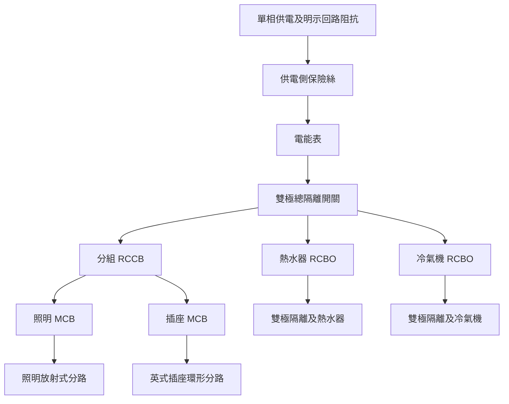

# 家庭電路工作台實施計劃草案

初稿：2026-10-13。更新：2026-10-14。狀態：實施中；H0決策見文末。採有效值模型；未執行的驗收仍保持未勾選。

建議新增「家庭電路工作台」，沿用 DC／AC 的共用編輯器，以有效值求解家庭電路，再加入保護及電能的時間狀態。首版不逐點求解50 Hz波形；市電仍明確標示為交流，家電採等效電阻。第一個完整交付是可自由操作的非評分工作台；之後再從同一核心製作分題 SCORM 活動。

教學主線是：**市電怎樣經火線及零線供電 → 家電怎樣並聯及分路 → 電流過大、短路與漏電有何不同 → 各種保護裝置如何配合。** 首版包括英式三孔插座、保險絲、MCB、RCD、接地、環形幹線、照明、熱水器、冷氣機及功率量測。

本計劃沿用[共享產品與樣式規則](00-shared-platform-and-style.md)、[生產與驗收契約](../docs/simulation-scorm-production-guide.md)、[新活動計劃模板](NEW-SIMULATION-PLAN-TEMPLATE.md)、[電路活動作者指引](../docs/circuit-activity-authoring.md)及[共用架構責任](../docs/circuit-workbench-architecture-review.md)。以下記錄家庭電路特有的決策；共用契約仍以原文件為準。

## 範圍與預設決策

| 決策 | 建議 |
|---|---|
| 名稱及 slug | 家庭電路工作台；`circuit-household-workbench` |
| 對象 | 已學串並聯、電流、電壓及功率的中學生；術語用繁體中文，保留 L／N／PE、MCB／RCD／RCBO |
| 供電 | 一個單相正弦市電源；預設 230 V 有效值、50 Hz；教師可選明示的 220 V 課本情境 |
| 計算層次 | 有效值／準穩態：電壓、電流讀有效值，功率讀平均有功功率；每次接線或開關狀態改變後重算電阻網絡 |
| 第一個完整產品 | 非評分 standalone 工作台，可在 Live Server 開啟及包成獨立 ZIP；Moodle 用 File resource 部署 |
| 主要操作 | 接線、開關家電、配置分路、選擇額定值、量測、加入／排除故障、比較保護動作 |
| 共用核心 | `CircuitEditor.mount(host, config)`；重用電阻網絡求解，新增明確的家庭有效值語義與保護事件；保留 DC 和一般 AC 入口 |
| 技術 | 原生 HTML／CSS／JavaScript／SVG；沿用已有本地數學字形與儀表，不新增框架 |
| 評量風險 | 工作台屬 formative，不評分；日後學生包限形成性／低風險評分，高風險用途另需可信伺服器驗證 |
| 本輪交付 | H0–H5非評分工作台；H6後續學生評量包另立活動計劃 |

澳電目前列明用戶單相供電為 230 V、50 Hz，因此採此預設；220 V 是可選課本設定，所有功率與電流均隨設定重新計算。[澳電供電資料](https://www.cem-macau.com/en/about-cem/company-profile/operation/)

英式插座規格、供電電壓及接地／配電制式分開設定。環形幹線列作教學配置；首版接地採明示供電端 N–E 連結的 TN-S 型等效模型，不宣稱這就是所有澳門住宅的實際配置。畫面說明為「電路原理模擬」，不輸出住宅施工合規結論。

首版不展開三相配電、高壓輸電、太陽能回送、UPS、電動車充電、雷擊、電弧故障、住宅 CAD、電工認證測試或各地法規選線計算。冷氣機先以指定額定功率的等效負載呈現；真實壓縮機、啟動電流及變頻器另屬後續模型。

這次簡化直接服務教學目標：學生集中比較接線、電流大小、功率及保護範圍。預設畫面只需「市電 230 V~ · 50 Hz」及一句「電壓、電流以有效值表示」。正弦波、峰值與方向往返放入可展開的交流原理卡，不設必看的示波器、相位或頻率操作。時間仍用於累熱、延時跳掣與電能累積。

## 現有 AC 和 DC 可重用的部分

以下電路能力按2026-10-13本地`9c0a691`原始碼盤點，屬設計依據，不代表重新執行既有測試。2026-10-14另以`a2ec9db66e260d6d55a067e3be356231dce63bad`的項目指引、registry、選取器及打包工具更新測試規劃；實施時仍須核對當時版本。

| 現有能力 | 家庭工作台的用法 | 需要補足的部分 |
|---|---|---|
| 共用 editor、profile、權限及只讀 | 原樣沿用掛載、工具箱、接線、撤銷、縮放、卸載與受限操作 | 家庭元件及相關命令須接入同一權限管道 |
| 多端子 registry 與 SVG renderer | 製作插座、插頭、RCD、配電箱外觀 | 新端子及內部支路、電流路徑、讀值語義與端子視角 |
| DC 使用的共用電阻網絡求解 | 在單一正弦源、純電阻假設下，以有效值直接求穩態電流及功率 | 明確區分家庭有效值與DC／瞬時讀值；增加家庭元件內部支路及保護事件 |
| 現有 AC 時間後端 | 作純電阻基準的交叉核對；日後進階交流研究仍使用原AC工作台 | 首版家庭運行不依賴逐週期求解；不為原理卡新增完整波形管線 |
| 有電阻導線 | 算環形兩側分流、線路壓降、故障回路及發熱功率 | 導體角色、實際長度、載流額定與線段熱狀態 |
| A／V／W 儀表及探頭 | 沿用量測與數學顯示；提供家庭量程預設 | 全屋／分路摘要、插入式功率計與累計 kWh |
| 保存與原子恢復 | 沿用文件驗證、原子替換及preview隔離的契約 | 家庭只保存拓撲、保護慢變狀態及電能；另定版本，不繼承AC相位及取樣歷史 |
| DC 評量外層與 SCORM 共用 runtime | 日後學生包可引用同一提交及恢復流程 | 家庭題目、rubric、精簡 codec 與驗收仍由各活動新增 |

有三項必須在開發前處理：

1. **現有 AC 電源保護是電子電源回饋限流。** 它會降低波幅，不能當作家庭保險絲或空氣開關。家庭有效值模型不採用該回饋，使用明示供電電阻及獨立保護元件。[現行 AC 模型](../docs/circuit-ac-workbench.md#可選交流電源保護)
2. **現有通用導線過載提示有 5 A 閾值。** 家庭支路的額定值各異，必須新增按線段／元件額定判斷的能力；不能讓正常熱水器電流直接套用實驗導線警告。DC 的預設行為保持相容。
3. **註冊新外觀並不足夠。** 求解模式、元件內部支路、量測、hazards、文件驗證及profile都要接通。現有文件只接受DC／transient等既定模式，並無家庭有效值接口；須新增最小而明確的模式識別及轉接，不能把有效值塞進語義為瞬時值的欄位。`CircuitAC.supported`和transient編譯不必為首版家庭模型全面擴充。

實際原始碼入口包括[通用電學及警告](../sim/circuit-workbench/circuit-solver.js)、[文件模型](../sim/circuit-workbench/circuit-model.js)及[統一打包器](../tools/package-circuit-platform.js)；[交流元件](../sim/circuit-workbench/circuit-ac-components.js)和[時間模型](../sim/circuit-workbench/circuit-transient.js)提供既有行為參考。盤點時有保護AC session程式版本為v5、舊架構文件曾記v3；兩者均不是家庭有效值保存格式，不能直接沿用為新模型已獲支援的證據。

## 教學內容及可觀察結果

| 主題 | 學生實際做甚麼 | 應能解釋的結果 |
|---|---|---|
| 單相市電 | 量度 L–N、L–PE、N–PE有效值；需要時展開交流原理卡 | 市電是交流，方向週期往返；230 V是有效值；波形及20 ms週期屬延伸說明 |
| 火線及零線 | 切換 L 或 N 上的單極開關 | 兩種接法均可能令負載停止，但斷 N 後負載內部仍可能相對地帶電 |
| 保護地線 | 比較外殼接地、斷地及絕緣故障 | PE 正常不承載工作電流；故障時提供回路，配合保護裝置切斷供電 |
| 並聯家電 | 開關第二件電器 | 各支路相對獨立，總電流增加；有線阻時端電壓可能略降 |
| 英式插頭與插座 | 辨認三孔、接 L／N／PE、觀察插頭內保險絲 | 插座正面與插頭針腳面會鏡像；導體按端子身份接通 |
| 保險絲 | 選 3 A、5 A、13 A；比較同負載及故障 | 額定值不是一超過便瞬間熔斷；熔斷後需要更換 |
| MCB 空氣開關 | 增加負載及加入 L–N 短路 | 過載與短路的動作時間不同；跳掣後需手動復位 |
| RCD 漏電保護 | 改變漏電支路、查看 L／N 感測電流 | 偵測流出及回流的不平衡；不能用總負載功率代替 |
| RCBO | 與 MCB＋RCCB 分立裝置比較 | 同一裝置具有過電流與剩餘電流保護 |
| 全屋分路 | 分別操作照明、插座、熱水器、冷氣分路 | 支路保護範圍不同；總開關與支路開關功能不同 |
| 環形幹線 | 比較完整環、某處斷線及負載位置 | 各插座仍是並聯；兩側分流通常不相等；有電不代表環線完整 |
| 功率與電能 | 開關家電，觀察 W、kW、kWh | 功率是用電快慢，電能是隨時間累積；插頭、拖板與分路有不同限制 |

工作台容許錯誤接線並呈現其後果。例如 L／N 反接不應自動修正，PE 斷開不應讓家電無故停止。導線顏色及吸附只協助辨認和操作，不代學生回答。

零線是正常回流導體，不能因名稱有「零」便教成任何情況都可安全接觸；其電勢受負載壓降、斷線與錯接影響。首版理想絕緣下PE的正常工作電流為零；進階示例可加入已標示的小漏電支路，比較多件電器的剩餘電流累加。

## 一個工作台的三個觀察尺度

工作台使用同一份電路、同一個時間狀態。尺度切換只改相機及展開程度，不另外建立互相矛盾的房屋圖與電路圖。

| 尺度 | 畫面與操作 |
|---|---|
| 全屋概覽 | 一個簡單住宅示意，顯示房間、配電箱及各分路；點選房間／分路即可定位；顯示通電、斷路、故障及分路電流 |
| 分路接線 | 展開 L／N／PE、插座、燈與家電；沿用現有拖線與接點操作；環形／放射式配置在此比較 |
| 元件原理 | 選取插頭、RCD、MCB或家電後，在面板／放大視窗查看接線與內部原理；視窗讀同一狀態，不另跑模擬 |

另保留「實物／電路符號」外觀切換。全屋外觀先用簡單原生 SVG；不製作 3D 房屋、走入式場景或裝修編輯器。

工具箱按功能分為供電與配電、保護、開關與插座、家電負載、量測五組；故障由選取物件後的「故障實驗」面板加入。教師可以自由搭建，入門示例只展示當課所需元件。

## 全屋預設配置

首版是一個有客廳、睡房、廚房與浴室的教學住宅。提供四條主要分路，並能切換兩種配電箱示例：共用 RCCB 加各路 MCB，以及各路 RCBO。兩種示例分別說明保護原理與停電範圍。

上圖表示功能關係；L、N、PE 的具體規則如下。

| 導體 | 預設路徑與邊界 |
|---|---|
| L 火線 | 經相關隔離及過流保護到負載；插頭保險絲及一般單極開關設於 L |
| N 零線 | 經所屬 RCD／RCBO 的 N 路回供電端；同一 RCD 下可用相應零線排，不同 RCD 群組不混接回流 |
| PE 保護導體 | 由主接地端子到插座 E 孔及 I 類家電外殼，保持連續；不串入普通開關或保險絲，也不穿過 RCD 的差流感測路徑 |
| 供電參考 | 在供電端明示 N–E 關係及返回源的路徑；住宅下游的 N 與 PE 分開；錯誤 N–PE 連接是可選故障 |

| 分路 | 初始負載例子 | 教學器件預設候選 |
|---|---|---|
| 照明 | 兩個可獨立開關的額定 60 W 等效燈 | 6 A MCB，放射式 |
| 一般插座 | 三個插座，選用 100 W 桌燈、2 kW 水壺、2 kW 暖爐 | 32 A MCB，環形；有獨立放射式比較預設 |
| 熱水器 | 額定 3.5 kW 電阻型熱水器 | 20 A RCBO，固定接駁及雙極隔離 |
| 冷氣機 | 額定 1.5 kW 等效電氣負載 | 16 A RCBO，獨立分路及雙極隔離 |

以上功率及額定值是**待模型基準核准的教學配置**，不形成真實家居選線表。選定示例的導線允許電流、回路阻抗及保護曲線須在同一份配置列明。高功率固定家電不一概接成 13 A 插頭；配電箱總開關的額定載流量，也不代表它本身具有過流跳掣功能。

首版規模以一個供電源、四條分路、約 6–10 個負載作驗收基準；初版先維持核心現有 80 元件、240 導線的上限，再以編譯後支路數量測效能，不能只看畫面圖示數目。

## 元件清單及行為

| 元件 | 必要電氣內容 | 可操作與顯示 |
|---|---|---|
| 單相市電及接地參考 | 單一正弦源的有效值模型、L／N／PE邊界、明示源及回路電阻 | 額定有效值、50 Hz交流標示、實際端電壓有效值；教師設定220／230 V |
| 供電側保險絲 | 上游 L 的過流保護 | 供電範圍與狀態；一般學生示例固定，不可任意增大額定值 |
| 雙極總隔離開關 | 同時斷 L／N 的兩組聯動觸點 | 合／分閘；不自行充當 MCB |
| MCB | 過載熱狀態、短路快速動作、L 觸點 | 額定電流、曲線、正常／手動關閉／跳掣、原因、復位 |
| RCCB | L及N感測、雙極聯動觸點 | 額定載流量及剩餘動作電流分開；TEST、跳掣、復位 |
| RCBO | 同一觸點組的過流及剩餘電流機制 | 顯示實際觸發原因，避免外觀相近便混淆功能 |
| N 排及 PE 排 | 各自的多接點導通與所屬群組 | 能展開接點；禁止圖形相疊就自動共接 |
| 英式三孔插座 | L／N／E 三個獨立接點及插座開關 | 正面孔位、背面端子、13 A標示及所屬分路 |
| 英式插頭 | L路保險絲、N、PE、三個接腳 | 透明外殼檢視、選保險絲、插入／拔出 |
| 拖板 | 一條共同軟線、總額定值及插頭保險絲，插孔並聯 | 多件負載合計；各孔數量增加不增加拖板總額定電流 |
| 照明開關及燈座 | 單極 L 開關、額定負載 | 正常及錯接到 N 的比較；燈滅與內部帶電分開顯示 |
| 家電負載 | L–N功能負載、I／II類及絕緣結構；可接觸導電部位才設獨立節點 | 額定功率、運作狀態、與絕緣類別相符的故障；II類示例不要求PE |
| 導線與接頭 | L／N／PE身份、電阻、允許電流、可選接觸電阻 | 逐線電流、壓降、發熱；故障斷點須可定位 |
| 功率及電能計 | 對明確邊界量度真實有功功率，再積分電能 | 家電、分路、全屋 W／kW／kWh；不可只相加銘牌數字 |
| 故障支路 | 指定位置的開路、低阻短路、絕緣漏電或接觸不良 | 故障開／關及阻抗；在展開圖可看見其電氣路徑 |

英式插座以正面、地孔向上為基準：上方 E、左下 N、右下 L。插頭顯示針腳面與接線面的切換必須明示視角，孔位對應使用端子身份而非畫面左右。元件原理圖呈現插座安全門及較長地腳；II類器具可有絕緣的安全門啟動腳，不能教成所有三腳插頭均接了保護地線。英式插座安全門由插頭插入機構開啟，具體結構依所選型式繪製。[IET 插座機構說明](https://electrical.theiet.org/wiring-matters/years/2020/80-may-2020/socket-outlet-protectors/)

導體預設棕色 L、藍色 N、黃綠相間 PE，並附字母及線型，避免只靠顏色識別。插頭保險絲以 3 A／13 A 作常見示例，5 A 作另一規格比較；實際配用仍取器具指定值與軟線條件，不能把「比 P/U 大一級」當作所有器具的通則。[Electrical Safety First 插頭與保險絲說明](https://www.electricalsafetyfirst.org.uk/safety-advice/home-and-people/house-maintenance/plugs-and-fuses/)

## 物理與數值模型

### 市電及負載

首版採**單一正弦電源、純電阻網絡的有效值／準穩態模型**。電源、導線、工作負載、漏電及接觸路徑均按明示的電阻等效；每次拓撲、觸點或阻值改變後重算網絡，狀態不變時沿用同一組有效值。首版不包含L／C、相位差、整流器、諧波或真實馬達；匯入不受支援元件須明確拒絕，不能默默套用純電阻結果。

此範圍內可重用現有線性電阻求解的數學運算，以`Uᵣₘₛ`作源的係數，得出各支路有效值和`P = UᵣₘₛIᵣₘₛ = Iᵣₘₛ²R`。內部電壓及電流係數保留相對共同正弦基準的正負號，供KCL及感測邊界計算；儀表顯示其非負有效值大小。這是交流有效值的等效計算，文件、電源圖示及UI均不把市電改稱DC。[OpenStax 有效值與電阻電路](https://openstax.org/books/college-physics/pages/20-5-alternating-current-versus-direct-current)

第一版電熱器、燈與冷氣機圖示的功能負載採額定點等效電阻：`R = Uₙ² / Pₙ`。運作時用求解所得端電壓計算功率，不能一直強迫負載吸收銘牌功率。冷氣機此時只用於分路、負載總量及故障教學；不解釋馬達功率因數或啟動特性。

家電的`Uₙ、Pₙ`是獨立銘牌參數；調整市電有效值不會自動改銘牌或等效電阻。若載入220 V課本示例，所選家電的額定電壓由該示例明示。另以同一件230 V家電接220 V驗證功率按`U²/R`下降，避免把換供電設定誤做成恆功率負載。

學生可直接使用課本形式的`I = P/U`、`P = UI`及`E = Pt`；例如理想230 V端電壓下，2.3 kW電熱器取10 A。面板首次說明這裏的U／I是有效值、P是平均功率，之後不用在每個數字重複長下標。真實感性負載的有功功率還受功率因數影響，首版不把上述假設推廣到所有家電。[OpenStax 交流功率與相位](https://openstax.org/books/university-physics-volume-2/pages/15-4-power-in-an-ac-circuit)

交流原理卡可用`u(t) = √2 Uᵣₘₛ sin(2πft)`說明電壓往返及有效值；230 V對應峰值約325 V。這是依正弦假設繪製的概念圖，並非求解器錄得的暫態波形；首版不設瞬時探頭或可調相位。50 Hz是供電說明，不是學生須操作的參數。

獨立的模擬時鐘只推進保護累熱、動作延時及電能。暫停凍結這些量；播放倍率只改觀看速度。無須保存來源相位、逐週期積分或RMS取樣窗，也無須等待幾個週期才顯示讀值。

### 導線與環形幹線

導線採有限正電阻，計算 `ΔU = IR` 及 `P線 = Iᵣₘₛ²R`。首版直接提供校準好的線段電阻與教學載流額定；只有課程需要比較材料／長度／截面時才開放 `R = ρℓ/A`。實際長度與畫布線形分開，拖彎圖上的線不會改變電阻。

環形分路的 L 兩端回同一保護器輸出，N 兩端回同一所屬零線排；PE按示例保持連續。各插座跨接於 L–N，沒有把電器串成一圈，也沒有第二個電源。

對單一抽取點的簡化測試，兩條 L 路徑電阻為 `R₁、R₂` 時，分流應滿足 `I₁/I₂ = R₂/R₁`；多抽取點用完整節點解。N 與 PE 各自求解，不從 L 複製電流。若全部使用理想零阻線環，電流可能不唯一，必須保留未知，不能硬分一半。

要分別演示斷一條L、斷一條N、斷一條PE及整段電纜中斷；仍能供電的插座也要顯示環線完整性缺失及各線段負擔。是否過熱取決於負載位置、線段額定與時間，不能一斷環就預寫必定跳掣。環形與放射式是兩種配置，環形並非所有住宅的必要形式。[IET 環形分路說明](https://electrical.theiet.org/wiring-matters/years/2020/80-may-2020/back-to-the-forum/)

### 保險絲及 MCB

保險絲與MCB均按照實際電流和經過時間動作，不直接看家電數量或總W數。

| 模型 | 必要行為 | 校準要求 |
|---|---|---|
| 保險絲 | 積累與`Iᵣₘₛ²`有關的週期平均熱作用並考慮冷卻；達熔斷條件後成為開路，狀態鎖定 | 使用獨立具名的教學時間電流曲線；額定電流附近不能一越界便瞬斷；不同額定值分別校驗 |
| MCB熱動作 | 過載較小時延時較長，負載移除後逐步冷卻 | 保存熱記憶；不能每次切換畫面／暫停便變冷 |
| MCB快速動作 | 大故障電流觸發快速斷開，與熱動作取先發生的事件 | 初版只提供一組清楚標示的曲線；若使用B／C型名稱，採相應型號或標準的完整曲線資料 |
| 導線發熱 | 線段耗散及熱狀態獨立於保護器 | 可以呈現「局部線段超載但上游總電流未達動作條件」 |

可用週期平均的一階熱平衡`dθ/dt = a·Iᵣₘₛ² − b·θ`作教學實現；`θ`是相對環境的熱狀態，`a、b、θtrip`按具名曲線校準。熱狀態隨模擬時間改變，不需要50 Hz取樣。未經材料熱容及散熱校準，不顯示精確攝氏溫度或失火倒數。若教學曲線刻意加快，面板須說明其教學時間尺度，不能讓學生把秒數當實物規格。

H0交付每一曲線的資料表：額定值、適用波形、熱常數／曲線點、快速動作條件、冷卻、復位條件及基準輸入輸出。具體曲線未核准前，不把它列成已完成的保護模型。製造商所列B／C／D曲線的磁動作區間並不相同，額定電流也不是其瞬時動作值。[Hager 保護器資料](https://assets1.sc.hager.com/exports/files/19en_imc_catafr_web_289_chapters_446-561.pdf)

保險絲「更換」建立新的完整熔絲；MCB「復位」保留仍存在的故障和合理熱狀態。復位後故障仍在，裝置應再次按模型動作。首次跳掣顯示原因、位置、動作前電流與停電範圍；其後可重看該事件，不用裝飾火花代替電氣證據。

### RCD 和 RCBO

RCD監察同一感測邊界內的L及N。若採「L向負載、N回電源」的參考方向，一般原理為`iΔ(t) = iL(t) − iN(t)`。首版所有電流共享同一正弦基準，可直接由有號有效值係數計算`IΔ = |ĨL − ĨN|`；此處Ĩ是相對該基準的帶符號係數，並非兩個儀表的無號讀數。若兩方向均定義為流入負載，則使用有號和，整個模型保持同一約定。

上述標量簡化只在單源純電阻假設下成立。一般相位或波形不同時，`abs(RMS(iL) − RMS(iN))`不等於`RMS(iL − iN)`；日後加入感性或非線性負載，須先更換相應感測模型。不能只量PE，因漏電可經其他路徑回源。首版的剩餘電流由當前網絡即時計算，跳掣則仍按所選教學門檻及延時計時。

初版採30 mA額定剩餘動作電流的交流漏電教學配置，並把正常載流額定與30 mA清楚分開。實物30 mA裝置有動作範圍與時間要求，模擬器若選定單一觸發點，須明示這是所選模型，不把「小於30 mA」標成對人體安全。[ABB RCD原理及動作資料](https://library.e.abb.com/public/fc3d92ef8da94d38a3882b0b86afb552/ELAU%20RCD%20Local%20Whitepaper%202022_9AKK108466A8987_RevA.pdf)

普通RCCB只有剩餘電流保護；單純過載或對稱L–N短路不應由其漏電機制觸發。RCBO把過流及剩餘電流兩套機制組合到同一組觸點。[Schneider RCCB與RCBO區別](https://www.se.com/us/en/faqs/FA89258/)

TEST按鈕使用跨感測邊界的內部限流測試支路，不靠教師隨意接地，也不直接把狀態設成「已跳」。應由同一感測和跳掣模型產生動作；它不能當成所有外部PE接線均正確的證明。[ABB 測試回路說明](https://library.e.abb.com/public/fc3d92ef8da94d38a3882b0b86afb552/ELAU%20RCD%20Local%20Whitepaper%202022_9AKK108466A8987_RevA.pdf)

### 接地與外殼故障

I類器具的可接觸金屬外殼是獨立電氣節點。正常狀態下，功能負載接L–N，外殼接PE；加入「基本絕緣失效」時，L經有限故障電阻接外殼。故障電流必須有回到供電源的完整路徑，不能在地符號處消失。

II類首版示例明示採基本加補充絕緣，以簡單故障狀態呈現：只破壞基本絕緣時，補充絕緣仍阻隔L與可接觸導電部位；只有選擇「雙重絕緣整體失效」才建立該故障支路。非導電外殼不直接當成金屬節點，也不能只把I類器具移除PE就稱作II類。原理說明補充，實物II類亦可採加強絕緣，不必都是可分開的兩層；首版不另做介電材料模擬。[Electrical Safety First 器具絕緣類別，第6–7頁](https://www.electricalsafetyfirst.org.uk/media/1207/best-practice-guide-6.pdf)

首版TN-S型等效示例使用可見的供電端連結及有限回路阻抗；地線與源參考、外殼電勢都由同一網絡求得。斷PE時，外殼可經故障接近L電勢；沒有閉合漏電路徑時，不能因「外殼帶電」就自動讓RCD動作。接地與故障回路的模型依據見[IET 接地說明](https://electrical.theiet.org/bs-7671-18th-edition-wiring-regulations/faqs/earthing-and-bonding-faqs/)。

供電接地參考端點是電氣模型的一部分，與顯示用「設為0 V」分開。外殼對地電壓、帶電提示及家庭對地電勢疊圖均取`voltage(測點, 供電接地參考端點)`的有效值；接觸電壓則取兩個實際接觸端點之差。不能直接用現有solver的`potentials`，因它為每個孤立導通區各自選零點。與接地參考不連通或結果不唯一時顯示「對地電壓未確定／懸浮」，不能顯示成對地0 V或安全。更換UI參考不得改變上述結果、接觸電流及保護動作；任意參考的探頭讀值須另標出兩個測點。

人體只作「接觸路徑」的教學等效阻抗，展示接觸電流會受路徑影響，不推算傷勢、致命機率或安全接觸時間。可比較接觸外殼至地及同時接觸L–N；後者若全部電流經N回流，RCD未必能分辨。RCD只能提供其適用範圍內的附加保護。[HSE RCD說明](https://www.hse.gov.uk/electricity/faq.htm)

### 短路及多保護器事件

供電源及實際線段使用明示有限阻抗；故障支路可以很低阻，但不能整個回路都零阻後再裁剪電流。先算故障電流，再由各保護器自己的模型判斷事件。

保護器以當前有效值推進慢變熱狀態及動作計時；同一模擬時鐘在最早預計動作點停止推進。到達事件時原子切換觸點、重算電阻網絡、更新故障路徑，再繼續時間。相近的多個事件需有固定處理規則與時間容差，不能由元件陣列順序或畫面幀率決定。這個事件層不要求50 Hz逐點積分。

接地短路可能同時滿足過流及剩餘電流條件；上游與下游也可能同時動作。只有選定曲線及回路條件能支持時，才教「某一個先跳」；不預設支路掣一定快於總保護。數值求解失敗則顯示「計算暫停／讀值未確定」，不能冒充真實保護器跳掣。

首版呈現過載較慢、短路較快的教學差別；不預測合閘相位、第一半週峰值、電弧、限流熔絲的允通能量或實物精確切斷時間。日後加入馬達／感性負載時，須另定相位、啟動及斷開暫態模型，不能只添加一個外觀便沿用目前結果。

### 功率與電能

功率表讀平均有功功率；首版純電阻模型直接由同一參考方向的有號電壓／電流係數相乘取得，消耗功率為`P = UᵣₘₛIᵣₘₛ`，無須先生成再平均瞬時波形。四端W表保留接反後的符號語義。全屋、分路與單件家電的量測邊界明示；插入式功率計量其下游負載，配電箱電能表亦包括其下游導線損耗。

電能按模擬時間積分，`E(kWh) = ∫P(W)dt(s) / 3,600,000`；各事件之間功率固定時直接累加`PΔt`，事件點先結算舊狀態再採新功率。例如額定工作點的2 kW電熱器運作10分鐘，參考負載電能為0.333… kWh；有限線阻下另計實際負載功率及線損。

保留現有四端W表供原理教學；入門可直接使用家電插入式W計及配電箱摘要。儀表量程改用家庭尺度，例如300 V、20／40 A、5／10 kW，不沿用20 W實驗量程。有效值在網絡成功求解後即可顯示，沒有RMS「收集中」階段；不可唯一確定或求解失敗時顯示未知，不填零。

## 預設實驗與故障矩陣

以下全部屬第一個完整工作台的範圍。開發時逐個加入，使用者可從示例直接切換，無須先畫完整住宅。

| 編號 | 實驗 | 驗收時必須觀察的結果 |
|---|---|---|
| H01 | 市電與三線 | AC標示與有效值讀表清楚；可選原理卡明示是概念波形；N–PE由回路求解，不硬寫任何位置永遠0 V |
| H02 | 兩家電並聯 | 一件關閉不切斷另一件；源電流符合KCL |
| H03 | 開關接L與接N | 都可令電器停止；接N版本斷開後仍顯示負載側帶電位置 |
| H04 | 英式插頭與三孔插座 | 前後視角對應正確；L保險絲熔斷只斷L；PE不是功能回流線 |
| H05 | 選保險絲 | 正常負載配合指定器具要求；過小額定、合適額定、過大額定分開說明 |
| H06 | 拖板過載 | 多件家電的總電流可超過共同軟線／插頭額定，即使上游32 A分路未動作 |
| H07 | L–N短路 | 有限大電流、相應過流保護；無剩餘電流時RCCB不因短路自行動作 |
| H08 | 外殼漏電與PE正常 | 故障回路及外殼電勢可見；保護按實際電流、差流與時間動作 |
| H09 | 外殼漏電與PE斷開 | 可先帶電而未有足夠漏電；加入接觸路徑後按實際差流重新計算 |
| H10 | 漏電掣與過載掣比較 | 使用遠低於分路安培額定但高於所選剩餘動作條件的故障，展示保護分工 |
| H11 | TEST與接地完整性 | TEST能驅動自身感測回路；外部PE中斷不被TEST結果掩蓋 |
| H12 | 全屋分路 | 關照明／熱水器／冷氣分路只影響其控制範圍；共用RCCB跳掣則影響整組 |
| H13 | 環形與放射式 | 各插座並聯；有限線阻下兩邊分流，移動負載接入位置會改電流 |
| H14 | 斷環但仍有電 | 分別斷L／N／PE；顯示仍通電的插座、失去的連續性及線段負擔 |
| H15 | L／N反接與錯接N／PE | 能運作不代表接法正確；有負載時錯誤回流可產生差流 |
| H16 | 功率與電能 | 分路及全屋功率與求解吻合；電能按模擬時間累積；暫停不增加kWh |
| H17 | 接頭接觸不良 | 接觸電阻令局部發熱；總電流可能沒有超過上游額定 |
| H18 | I類與II類器具 | I類金屬外殼接地；II類基本絕緣失效後補充絕緣仍阻隔，與雙重絕緣整體失效比較；非導電外殼不當金屬節點，缺PE不一概判錯 |

H17可先顯示接頭耗散及風險，不要求燃燒動畫。教學示例預設一次一項故障；自由工作台可組合故障，至少驗證「過載＋漏電」及「斷地＋外殼故障」兩類組合。

每個示例包含初始配置、可見的量測點、教師可調項目及一個核心比較。操作指南與原理解說放於需要時開啟的面板；沿用現有工作台沒有常駐大段示例提示的習慣。

## 介面與手機操作契約

| 決策 | 家庭工作台規格 |
|---|---|
| 三區 | 頂欄：標題、示例、視圖及全螢幕；舞台：房屋／分路接線；面板：選取設定、量測及故障 |
| 桌面 | 約960 px以上舞台與面板並排；面板候選280–320 px，按配電箱資訊實測調整 |
| 手機 | 頂欄、舞台、可獨立捲動面板；屬bounded split-panel；先聚焦一條分路，避免全屋文字縮到不可讀 |
| 短視窗 | 320×500及390×500時仍可操作舞台及最後一項面板控制；用收合／原生對話框安放次要內容 |
| 字體 | 主要控制16 px；圖上必要標籤以實際畫面至少約14 px驗證；低縮放改用分路摘要及定位 |
| 全螢幕 | 外層一個完整活動target與header標記；載入`shared/fullscreen.js`；右上44 px按鈕保留標題空間 |
| 導線辨識 | L／N／PE固定顏色加字母／線型；可選對地電勢疊圖固定用供電接地參考，懸浮顯示未知，不覆蓋導體身份 |
| 電流圖示 | 預設以無方向的通電路徑高亮及有效值大小表示；需要方向解說才顯示共用紅色常規電流箭頭，標明「某半週的參考方向」；不畫永久單向流動動畫 |
| 交流資訊 | 常見位置標示230 V~／50 Hz及有效值語義；波形卡按需展開，清楚標示概念示意；數值與燈亮度不隨50 Hz閃爍 |
| 吸附 | 沿用接孔24 CSS px與20模型單位位置網格；同時有多孔時顯示候選，不暗中修正錯接 |
| 精密預覽 | 拖線到配電箱端子、插頭內部接線需要局部放大；開關、家電開關及粗略搬物件不另加預覽 |
| 導航 | 示例互相獨立，頂欄可直達；同一實驗不同尺度保留狀態；替換有改動的示例前顯示捨棄範圍 |

| 觸控開始位置或操作 | 擁有者及驗證 |
|---|---|
| 空白舞台、兩側32 px捲頁條 | 沿用共用手機捲頁能力，實際宿主捲動；不得開始接線或切換電器 |
| 面板中段、頂端、底端 | 只有面板捲動，舞台及Moodle外層保持；包含按鈕與文字上開始的滑動 |
| 元件拖動、接孔、線端、導線彎點 | editor穩定capture；移動期間不捲頁；取消／第二指／失去焦點不提交幽靈接線 |
| 插頭插拔 | 同一插接命令原子更改L／N／PE；首版採斷電編輯，避免未建模的帶電插拔過程 |
| MCB／RCD／家電開關 | 44 px以上點擊目標；點擊只改一次；滑動面板不誤開合 |
| 故障阻抗／負載滑塊 | 電氣參數預覽期間暫停該instance時鐘；放手才提交一次物理事件，取消還原；結束後恢復原播放意圖，不補算拖動期間牆鐘時間；鍵盤可調 |
| 示意圖展開與視圖切換 | 保留文件、時間、保護狀態；不可因展開元件便重新通電 |

配電箱端子有足夠間隔或獨立放大視圖，不讓三個44 px透明命中區互相覆蓋整片空白。鍵盤可選元件、端子、接線目標及插拔／開關；不把鼠標拖動設為唯一途徑。

## 架構與檔案責任

繼續採「共用引擎 → 可配置編輯器 → 活動／教師外層」。家庭入口重用同一editor及電阻網絡求解；有效值語義與保護時鐘接入共用分析邊界，由同一模型供應所有畫面及讀表。`main.js`只負責外層，不另寫一套電流算法，也不為家庭模式強制運行AC逐週期後端。

| 責任 | 建議位置及界限 |
|---|---|
| 家庭元件定義及圖形 | 可選的`circuit-household-components.js`，放共用電路目錄；包含端子、參數、內部支路、圖形及可觀察量 |
| 有效值分析 | 在既有分析模式選擇處增加最小家庭轉接；重用電阻求解、保留有號係數，對外明示RMS／平均功率；不複製求解器 |
| 保護模型 | 可選的`circuit-protection.js`；純狀態更新與動作判斷；由家庭模擬時鐘及事件排程呼叫，無需AC高頻取樣 |
| 接地與家庭物理資料 | 家庭元件／導體的權威模型；內部電阻支路及感測邊界編入同一求解網絡，觸點事件只更新所需狀態 |
| 文件及profile | 修改既有model／document／profile的必要邊界；未知欄位或型別拒絕；不從匯入資料取得教師權限 |
| 家庭介面 | `sim/circuit-household-workbench/index.html`、`styles.css`、`main.js`；配電箱面板和摘要有實際需要才拆出UI模組 |
| 情境 | 家庭入口自己的`presets.js`；負載、分路、故障及教學說明由此擁有 |
| 保存 | 家庭入口`persistence.js`處理外層封套；家庭分析session擁有熱狀態、動作計時、觸點及電能；共用核心繼續驗證電路文件 |
| 正式評量 | 日後各自`spec.js`、`scoring.js`、`persistence.js`；共用元件不藏本題答案 |

上述新增檔案名稱及家庭有效值分析模式均是實施提案，現在沒有現成接口。先補最小的內部支路、量測語義及保護事件能力；不建立通用插件市場或任意腳本執行接口。現有DC／AC文件的模式及讀值語義保持相容，跨模式匯入只接受明確可轉換的範圍。

開發順序須先證明：一個RCCB的四個端子、兩個聯動觸點、兩路感測能由registry→編譯→求解→量測→繪圖→保存完整往返。元件內部節點可作電氣實現，但只有畫面可見且合法的端子才提供吸附；不能靠隱藏元件留下看不見的接線孔。

現有單線可作第一版三線明示接線。三芯電纜的「折疊顯示」只是一組線的共同呈現；若加入整束搬移／插接，須是同一筆原子命令，保留三條導體獨立的連接、阻值及權限，不能用一條彩色線代替三個電氣節點。

家庭模型把「加入故障、跳掣、開關負載、復位」列為保持時間與熱記憶的物理事件；事件後重新解電阻網絡，不重建整個實驗。現有AC部分結構改接會建立新實驗的行為不能直接套用。自由搭建及插拔先採斷電編輯；單純移位、彎線、視圖切換均不改電氣狀態。明確的「新實驗」才按指定初態重設，undo／redo則恢復對應的文件及物理狀態並暫停。

家庭模式的只讀狀態凍結權威文件、熱狀態、動作計時及電能，仍容許移圖、縮放、讀表與全螢幕；解除只讀保持暫停，由明確播放才繼續。每個editor instance擁有自己的時鐘、保護及訂閱；`destroy()`必須全部停止。這些能力須接入新分析模式，不能假設現有只分DC／transient的history、preview及生命週期條件會自動涵蓋家庭session。

## 狀態與保存契約

工作台沒有作答phase或分數。電路的供電、保護狀態與全域播放模式分開：一條支路跳掣後，其他支路可以繼續運作，不能用全屋單一`tripped`旗標取代各保護器。

| 狀態範疇 | 權威資料及行為 |
|---|---|
| 電路文件 | 家庭有效值模式身份、供電接地參考端點、元件、端子、導線、實際阻值、銘牌額定值、等效負載模式、絕緣類別、故障種類及位置參數 |
| 元件動態 | 熔絲完整／熔斷；MCB及RCD手動關閉／閉合／跳掣；熱狀態、模型要求的動作計時及原因 |
| 時間 | 模擬時鐘、已結算時間及必要事件狀態；不保存來源相位、高頻取樣或逐週期積分歷史 |
| 電能 | 每個正式電能計的積分基準與累計值；不是顯示端每幀估加 |
| 衍生資料 | 有效值、有號電流係數、剩餘電流、當前總功率、警告、故障路徑、固定參考的外殼對地電壓及通電摘要，由權威狀態重算；未知不可變成零 |
| 暫態UI | 相機、選取、hover、手指位置、動畫粒子、放大窗及全螢幕，不用來判斷保護或電學 |

| 可保存情況 | 恢復後的合法續作 |
|---|---|
| 空白／未接妥 | 保留懸空與部分接線，繼續接線或載入示例 |
| 已完成且未供電 | 保留開關位置，學生可合閘 |
| 正常運作或手動暫停 | 恢復同一物理狀態但暫停；繼續後與不中斷運算一致 |
| 過載累熱、尚未跳掣 | 保存熱記憶及下一事件；恢復不能重新由冷態開始 |
| 單路／多路跳掣 | 保留各器件狀態、其他分路和故障；排故後手動復位 |
| 保險絲已熔斷 | 保留熔斷，須更換才再導通 |
| 技術計算錯誤 | 保存最後可信狀態及診斷；可以修復已知電路問題，不能偽造0電流或保護成功 |

工作台提供兩個明確檔案用途：「儲存電路配置」供下一次從初始狀態開始；「儲存目前實驗」則保存家庭模型完整的保護及電能session。開啟實驗先驗證，成功才原子替換，並暫停。沒有自動持久化；standalone刷新回到初始工作台，教師明確匯入則按所選檔案用途恢復。

家庭封套至少包含`kind`、`schemaVersion`、`modelRevision`、`scenarioId／scenarioRevision`、經共用驗證的電路文件及家庭保護／電能session。每個新增欄位須在H0列出精確型別、範圍、參照與版本策略，完成後才進入H1編碼；家庭新schema不能假稱舊AC v5已支援，也不攜帶與本模型無關的AC積分狀態。

熱狀態、RCD動作計時及累計電能會影響後續行為，必須保存；本模型沒有RCD波形觀察窗。每個上表狀態必須做正式encode→decode→restore，並至少執行一次合法續作，再比較保護次序、動作時間與電能。

零散但合法的接線與故障電路可保存；未知端子、重複ID、非有限數、非法額定值、錯誤群組參照及不可能的保護狀態才拒絕。檔案大小明確設上限並測最壞資料，禁止靠默默刪歷史才符合容量。

## 日後 SCORM 活動的拆分

**本工作台的rubric、最終提交及SCORM attempt lifecycle為N/A，原因是非評分工具。** 工作台完成後，建議新增四個短活動，而非把整間住宅任意接線塞入一份4000 bytes作答。

| 活動提案 | 任務及100分rubric草案 |
|---|---|
| 三孔插座及接地 | L／N／PE正確連接30；L保險絲及開關25；外殼接地25；原理解釋20 |
| 保險絲與負載 | 負載電流計算25；按題目器具資料選額定值35；拖板總負載25；過載／短路辨別15 |
| 漏電與保護分工 | 漏電回路辨認30；L／N差流25；預測會動作的保護器25；說明PE／RCD配合20 |
| 分路與環形幹線 | 指定分路25；L／N環路及並聯關係30；PE連續性20；斷環後分析25 |

上述是課程拆分提案，開發各活動前另按模板定完整題目、容差、部分分及phase／variant矩陣。共同要求是未碰過的預設圖不自動得分，空白可提交0分，獨立正確項目保留部分分，70分可作初始合格門檻但由教師定案。

數值題依量級分開：安培級負載電流可先採`max(0.01 A, |目標值|×1%)`；毫安級剩餘電流先採`max(0.1 mA, |目標值|×1%)`，再按題目精度定案。不能將10 mA的通用容差套到漏電題，例如23 mA的答案不應接受32 mA。數值部分分與「是否跳掣」的判斷分開；後者依題目指定模型及原始未捨入數值判定，不藉數值容差跨過動作條件。端子身份、保護類型及額定選項精確比對；每題驗證單位轉換及容差內外邊界，不能用接線吸附距離當電學評分條件。

評分以明確提交的最終接線、選擇與解釋為主。若題目需要觀察證據，另存已確認的觀察量及其條件；不能把跑過預設或只看動畫算作學生答案。過程評分另行定案。

未來學生包使用固定模板ID、有限端子配對及精簡參數編碼；保存權威答案、phase、目前題、review返回語義及必要實驗狀態。能以「每次從規定初態重播」完成的題目，先選這種模型；若允許中途恢復，熱記憶、動作計時及電能等亦必須有符合容量的正式方案。

所有draft、空白／部分check、edit-after-check、pending-final及recorded review均須通過正式round-trip與續作；包含共用封套的最壞UTF-8大小不超過4000 bytes。達不到時縮小題目，不截短權威資料。

接入`SimScorm.loadAttempt()`、`SimActivityFlow.startup()`、draft provider與`submitWithCallbacks()`的success／committed／frozen／retry四種結果；完成及pending均維持只讀，無清除成績／重考按鈕。Moodle同一attempt可恢復，standalone刷新重新開始；無效pending隔離、無效已交卷保持鎖定，依[共用生命週期](../docs/simulation-scorm-production-guide.md#mandatory-shared-lifecycle-flow)執行。

## 實施階段與交付

| 階段 | 工作與依賴 | 可審閱成果及完成條件 | 粗估有效工作天 |
|---|---|---|---:|
| H0 模型及教材定案 | 確定單源純電阻假設、RMS讀值及有號係數語義、230／220 V、接地等效圖、負載額定及保護曲線；完成危險情境預期表、精確snapshot schema、測試檔案／browser owner及source／package／手勢矩陣 | 一份有公式、參數單位及基準答案的模型規格；保護時間不留無標示的臨時常數；測試登記及選取預期明確 | 1–2 |
| H1 最小家庭回路 | 接入家庭有效值分析及新入口；市電、L／N／PE、英式插座、I類負載與W計；補內部支路、文件邊界、registry、資產清單、電路family選取及最小打包支援 | 單負載直接得有效值與平均功率；配置保存一致；`check:tests`通過，最小回路source／ZIP及DC／AC基本回歸有證據；首次整合提交按full範圍驗證 | 3–5 |
| H2 保護與故障核心 | 以慢變時鐘及事件整合保險絲、MCB、RCD、RCBO；短路、漏電、斷地、復位及熱記憶 | 一條插座支路完整演示正常→故障→保護→排故→恢復；數值及保存基準通過 | 4–6 |
| H3 全屋及環形分路 | 四分路配電箱、N群組、環形／放射式、拖板、固定大功率家電、總W及kWh | 開關及故障只影響實際保護範圍；分流／斷環／局部過熱案例可驗證 | 3–5 |
| H4 教學操作與手機 | 三尺度、原理放大、十八個示例、端子預覽、快捷設定、鍵盤及無障礙；擴充現有mobile-scroll runner，支援家庭standalone資源清單、ZIP打包／解壓、資源指紋及家庭手勢案例 | 每項概念有可直接開啟的示例；320 px上仍能接端子、讀表和操作最後控制；家庭T0–T3適用手勢矩陣在source與解壓standalone ZIP兩種來源均實際通過 | 3–5 |
| H5 成品驗收 | 在同一已提交SHA重建source／ZIP；執行完整物理／狀態／觸控矩陣及規定的全量自動驗證；核對registry、selection plan、資產消費者與打包指紋 | standalone package-ready；記錄base／head、GitHub run與實際scope，所有必需job及artifact齊備；真手機／Moodle另驗 | 4–6 |
| H6 學生評量包 | 工作台模型穩定後，再為各短活動定案並實作rubric、codec及SCORM | 每個活動各自通過package-ready與Moodle-ready；不繼承工作台的合格聲明 | 另估 |

H0–H5暫保留約18–29個有效工作天的一人開發粗估。有效值方案省去高頻積分、波形收集及相位保存，但家庭元件、保護事件、恢復與手機操作仍須完成；H1驗證共用求解接入後再縮窄估算，不把模型簡化直接換算成承諾工期。H1結束先看單回路原型，H2結束先看保護原型，再擴充全屋；每一階段都保留可獨立驗收的成果。

H0的精確schema、保護曲線及案例矩陣完成後，才進入H1實作。手勢runner的standalone接入及兩種來源的實測是H4完成條件，不能留到H5才補接測試工具。

## 測試計劃與數值基準

所有基準先由獨立公式／小型參考電路計算，再比較產品求解，避免測試重複呼叫同一實現便宣稱正確。

| 基準 | 預期或量測要求 |
|---|---|
| 單一230 Ω純電阻接理想230 V源 | 1 A RMS、230 W；加入明示源及線阻後按完整串聯阻抗重算 |
| 改變供電而保留同一銘牌 | 固定23 Ω負載在230 V時為2.3 kW，改220 V後為`220²/23` W；不得偷偷調R或維持2.3 kW |
| 230 Ω與460 Ω並聯 | 理想端電壓下為1 A與0.5 A，總1.5 A、345 W |
| 有限電阻環形單抽取點 | `I₁/I₂ = R₂/R₁`；對稱才相等；交換線段記錄方向只反轉有號量 |
| 差流 | L／N平衡時為零；指定漏電回路的差流與獨立解吻合；反轉記錄方向仍得相同剩餘電流大小，避免誤用無號讀數 |
| 簡化邊界 | 不支援的L／C、不同相位來源及非線性負載明確拒絕；原理卡不被當成實測波形；有效值不等候取樣窗 |
| 共用求解及模式相容 | 純電阻基準先對獨立公式，必要時與既有AC穩態RMS交叉核對；家庭運行不載入AC逐週期後端；DC／AC匯出與讀值語義不變 |
| 漏電解析示例 | 理想230 V跨指定10 kΩ漏電支路為23 mA；這是電路算例，不預判所有30 mA實物裝置必定不動作 |
| 對地參考不變性 | 將L或故障外殼設為UI的0 V，對地讀值、帶電提示、接觸電流及保護結果不變；同時核對探頭明示的參考 |
| 懸浮部位 | 完全孤立的外殼或零線對地讀值為未知，不拿孤島局部0 V代替；建立已知接觸路徑後按新網絡重算 |
| 絕緣類別 | I類基本絕緣故障建立L–外殼支路；II類只失去基本絕緣仍不建立接觸通路，雙重絕緣整體失效才建立；非導電外殼不形成虛構導體 |
| 電能 | 恆2 kW積分600 s為1/3 kWh；暫停及視图操作不改積分 |
| 曲線 | 各額定值在低於額定、額定附近、中度過載及快速故障電流下符合已核准模型；包括邊界前後 |
| 動作時間 | 改變幀率／播放倍率不改模擬動作時間；慢變時間步加密後收斂至同一事件順序；不宣稱驗證了50 Hz半週內暫態 |
| 高低量級共存 | 全屋數十A負載下仍能分辨mA剩餘電流；大數相減不可吞掉漏電 |
| 綜合事件 | 同時過載／漏電、上下游候選動作、復位仍有故障；結果不依元件排列次序 |

家庭session另有一組操作隔離基準，不能由既有DC／AC回歸代替：

| 操作 | 必須保持的結果 |
|---|---|
| 參數預覽及取消 | 從已累熱的合法狀態開始，預覽期間時鐘、熱量、計時及電能不變；取消後文件與session完全相同；提交只產生一次事件，之後不補算預覽期間時間 |
| undo／redo | 各自恢復對應命令邊界的文件、故障、保護、時間及電能，並暫停；再播放與該快照直接恢復的續作一致 |
| 匯入失敗 | 非法JSON、版本或跨欄位狀態均保留原文件及session；技術提示不把保護狀態改成已跳掣 |
| 只讀與解除只讀 | 只讀期間及解除後尚未播放時，權威狀態不變；變更命令拒絕，移圖／讀表／全螢幕仍可用 |
| 多instance與卸載 | 同頁兩個工作台的時鐘、故障與訂閱互不影響；卸載其中一個後其時鐘及回呼停止，另一個可繼續 |
| 斷電與暫停 | 時間繼續而電流歸零時熱狀態可冷卻；按暫停時冷卻及電能一同凍結，避免把斷電等同停止時間 |

初步數值驗收目標：正常穩態U／I／P解析基準相對誤差≤0.5%；接近零值另設量綱相符的絕對誤差；差流基準誤差≤0.1 mA；恆功率電能誤差≤0.5%。事件時間按選定曲線及步長收斂結果設定專用容差，不能以螢幕幀率作容差。以上為待H0基準確認的工程目標。

首版效能目標：一般四分路示例保持可操作，控制回應約100 ms內；拖動中模型與視圖保持一致；若實際速度落後，顯示實際模擬倍率，不能跳過保護事件來追趕牆鐘。於桌面及目標手機量測編譯、求解、繪圖和記憶體；事件顯示歷史有上限，概念波形不建立取樣歷史。

互動驗證至少包含320×500、390×500、390×600、正常手機直向、橫向、短iframe、鍵盤及200%縮放。source與解壓ZIP均以可信輸入驗證接線、插拔、開關、滑塊、取消、側條及面板邊界，並記錄不應移動的所有捲動層。

T0直接開啟、T1直接iframe、T2嵌套player及T3元素捲動宿主沿用[完整手勢契約](../docs/simulation-scorm-production-guide.md#selective-touch-gesture-ownership)。T4真Moodle與真手機另記，包含實際origin／sandbox／捲動owner；本地模擬不能代替。Windows上的Playwright CLI按AGENTS指定Git Bash路徑執行；輸出含`### Error`一律視為失敗。

### 測試登記與CI選取

依[測試登記程序](../docs/simulation-scorm-production-guide.md#test-registration-for-new-simulations)及[CI驗收規則](../docs/simulation-scorm-production-guide.md#ci-gates-and-maintenance-commands)，`tools/test-registry.js`是唯一登記來源；`tools/run-tests.js`只執行該清單，不另加測試列表，也不修改歷史baseline JSON來登記新測試。以下是家庭工作台的實施決策；新檔案須隨實作建立及登記，本輪沒有預先登記不存在的檔案。

| 項目 | 家庭工作台的安排 |
|---|---|
| Runtime資產 | 在registry的`assetLists`加入`{scope:'circuit-household-workbench', file:'sim/circuit-household-workbench/assets.json'}`；清單`files`相對於`sim/`，列齊入口及實際共用依賴；首版沒有SCORM manifest |
| 物理與保護Node測試 | 擬用`sim/circuit-workbench/household-model.test.js`、`household-protection.test.js`、`household-session.test.js`，覆蓋上列數值、曲線、事件、文件及恢復基準；各檔加入`registeredTests`，kind為`node`、預設scope為`circuit-workbench` |
| 家庭情境Node測試 | 擬用`sim/circuit-household-workbench/presets.test.js`核對H01–H18配置及預期模型條件；登記於`registeredTests`，kind為`node`、預設scope為`circuit-household-workbench` |
| Browser owner | 擬登記`{file:'tools/circuit-household-browser-regression.js', kind:'browser', scope:'circuit-family', args:[]}`；同一entry內執行source與實際解壓家庭ZIP，逐案記錄兩種來源，缺任一模式或必需案例即失敗 |
| Browser case helpers | 首版不為登記而拆檔；若案例需拆成`tools/circuit-household-browser-cases.js`，同步在`helpers`登記`scope:'circuit-family'`與實際`consumers`，由已登記driver以literal relative CommonJS import引用；helper不當成獨立test執行 |
| 獨立部署矩陣 | 擴充已在`manualBrowserTests`登記的`tools/mobile-scroll-browser-regression.js`（`shared-touch`）；H4接入家庭standalone `assets.json`、實際ZIP打包／解壓與入口定位、source／ZIP資源指紋，以及家庭案例／操作adapter；T0–T3適用矩陣在兩種來源均須實際通過並保留證據；若新增獨立driver，另列file、scope及非空reason |
| 後續SCORM包 | H6按各自slug登記manifest與Node tests，browser依電路消費者規則歸`circuit-family`；同步加入family套件對應及反向資產消費者驗收 |

現有mobile-scroll runner的`runtimeDigest()`仍讀`sim/manifests/<slug>.xml`，package分支亦走SCORM打包；單純加入家庭slug會因首版沒有manifest而失敗。H4須按資源類型讀取已登記的standalone清單，使用統一電路打包器產生並解壓家庭ZIP，從實際被測來源計算資源指紋，記錄ZIP指紋及入口，並確認套件資源與同一SHA的來源一致。現有`--mode=standalone`表示直接頁面啟動，不能視為已支援standalone ZIP；宿主T0–T3與source／ZIP來源須能分別指定及記錄。同步補standalone接入回歸與既有SCORM路徑回歸，缺資源、入口或案例均須失敗；不以新增虛構manifest繞過接入工作。

最小回路即須有已登記的browser entry；後續階段在同一driver補齊案例，H5核對完整矩陣。預設一次entry涵蓋source／package，避免再登記重複呼叫；若實測後需要獨立分組執行，須逐一登記不同`args`，並確認所有組合都在選取結果中。保留現有DC四組source／package及其他電路browser entries，不以家庭entry取代它們。跨不同活動scope共用的helper按指南使用`shared-` scope。

**電路family仍需明確接入。** 核對時`tools/test-selection.js`的`circuitScopes`及family package集合只列DC、AC、兩個DC活動。H1須加入`circuit-household-workbench`，使家庭runtime、家庭driver/helper、共用電路資產及其反向消費者都能選到正確browser entries與五個電路套件。`tools/ci-plan.js`已把`circuit-`套件交給`circuit-platform-packages`，因此`tools/package-circuit-platform.js`亦須實際建出家庭ZIP並記錄其指紋；只在registry加入asset list並不足夠。

同時擴充既有`tools/test-selection.test.js`的選取斷言：家庭入口、共用電路檔及家庭helper均選到家庭browser與全部電路消費者；新家庭資產的反向依賴可追蹤；registry／catalogue／選取器改動為full；未知資產或缺browser owner仍保守回退full。現行以`sim/circuit-household-workbench/main.js`作未登記反例的測試，在家庭接入後改成正例，另留真正未知路徑的反例。這些是測試基礎設施接入工作，須和家庭runtime一同完成。

首次新增registry、catalogue及依賴／選取器的提交採**全量驗證**。日後已有同一policy下合格的main基線，且只改活動內容時，才採正式plan選出的affected範圍；家庭屬`circuit-family`，不能自行縮成只測家庭頁。共用行為改動依生產指南擴大驗收；現有電路核心的family選取也不能豁免指南要求的全量gate。登記錯誤須先失敗，未知映射回退full不能證明漏登記的測試已執行。

### 選取與執行證據

實作提交後，以`npm run test:affected -- --base=<main-sha> --head=<head-sha> --plan`檢查選取；兩個SHA均須已提交，checkout對應head。預覽不執行測試，也不涵蓋未提交修改；本地指定range與GitHub累積main／PR merge-candidate驗證分開記錄。

| 證據 | 須保存的內容與目前狀態 |
|---|---|
| Registry檢查 | 指令、被檢查版本、exit code及輸出路徑；本輪對現有registry的實際結果見文末2026-10-14記錄，家庭接入後須重跑 |
| 已提交selection preview | base／head完整SHA、輸出檔、mode／reason、每個browser的file及args、packages；初次應為full，後續須包含家庭與所有反向資產消費者；尚待實作提交 |
| 實際自動驗證 | 測試SHA、workflow版本、GitHub run連結、policy、選取scope、各必要job／entry結果及報告；full時包括全部已登記測試、全部SCORM套件及standalone電路平台；尚待實作 |
| 產品驗收 | 同一SHA的source／解壓ZIP、套件指紋、H01–H18、session及手機矩陣的執行結果與artifact路徑；CI成功不能代替未執行案例；尚待實作 |
| 獨立部署證據 | H4完成家庭standalone runner接入；T0–T3完整host／phase／mode矩陣在source及解壓ZIP各有實際報告、資源／ZIP指紋與入口；T4實機／Moodle另記，保留未完成項目；尚待實作 |

H5按[package-ready規則](../docs/simulation-scorm-production-guide.md#package-ready-checks)執行`npm run check:tests`、`npm run check`、`npm test`、`npm run package:all`、`npm run package:circuit-platform`及`git diff --check <base>...HEAD`。`test:fast`供開發時跑非browser測試；`test:affected`供合格range的選取與執行，均不代替首次整合或交付所需全量驗收。自動產生的assets／manifest先更新並提交，再在該SHA重建，確保CI的tracked-checkout守衛通過。獨立Quality Full、手機及Moodle驗收各自保留；必需job或artifact缺失不能記作通過。

## 打包與目錄規劃

| 項目 | 實施時的修改 |
|---|---|
| 工作台入口 | 新增`sim/circuit-household-workbench/`及其`assets.json`；同步在registry的`assetLists`登記，建立反向資產消費者 |
| 可選家庭依賴 | 按實際共用檔建立`household-runtime-assets.json`；DC入口不額外載入家庭模組；家庭包不因交流標示而自動包含完整AC時間後端 |
| 統一builder | 擴充現有`tools/package-circuit-platform.js`產生家庭ZIP，納入`circuit-platform-packages`及五個電路套件指紋；assets／manifest重建後不能留下未提交差異 |
| 既有套件 | 共用核心改動後重建DC、AC及兩個DC活動；按受影響邊界執行回歸 |
| 目錄metadata | title「家庭電路工作台」；folder同slug；categories「Electricity」；description「探索家庭分路、英式插座、接地與保護裝置，模擬過載、短路及漏電。」；tags為physics、electricity、household、safety、workbench；可部署前status為planned |
| 測試 | 新Node／browser測試登記`tools/test-registry.js`的`registeredTests`；helpers及manual gates亦按類別登記；family與套件映射、選取斷言見上節，缺覆蓋必須失敗 |
| 文件 | 家庭作者／維護指引記錄模型、接口、故障、保存及已驗證範圍；本計劃維持教學決策與里程碑 |
| 學生包 | 日後各自`sim/manifests/<slug>.xml`，根有`imsmanifest.xml`，列齊實際共用依賴 |

Standalone包沒有評量manifest。`package:all`現時只建SCORM，不能假定會自動包含新工作台；須在統一builder明確加入它。新ZIP部署前核對主入口及離線資產，Moodle上的舊ZIP不會因原始碼更新而自動改變。

## Package-ready清單

- [ ] H0模型、曲線、示例參數、錯誤概念及獨立數值基準完成。
- [ ] 所有首版元件的電氣、觀察、圖形、權限及恢復均有實際覆蓋。
- [ ] 十八個示例可從UI開啟，正常、部分接線、故障及多分路狀態不互相污染。
- [ ] 所有保存狀態經production round-trip及一次合法續作，版本／非法輸入／容量亦測試。
- [ ] 家庭額定警告沒有沿用固定5 A通用假設；MCB／RCD／保險絲動作由物理模型產生。
- [ ] 有效值／平均功率標示清楚，單源純電阻限制確實驗證；方向及概念波形不造成DC或實測暫態的誤解。
- [ ] 固定對地參考、懸浮未知及I／II類絕緣故障基準通過；家庭session操作隔離各列均有正式測試。
- [ ] 原有DC／AC關鍵操作、文件及正式DC活動回歸通過，無家庭依賴洩漏到DC入口。
- [ ] source與解壓ZIP的手機、可信觸控T0–T3、鍵盤與全螢幕通過。
- [ ] H4已完成mobile-scroll runner的standalone資源、打包／解壓、指紋及家庭案例接入；source與ZIP的適用矩陣均有實際通過證據，沒有依賴不存在的SCORM manifest。
- [ ] 家庭Node／browser／helper／manual owner及standalone資產清單已登記；`npm run check:tests`通過且有輸出證據。
- [ ] 已提交base／head的selection preview符合預期；首次full、後續scope與反向消費者完整，沒有漏掉source／package參數組合。
- [ ] `npm run check`、`npm test`、`npm run package:all`、`npm run package:circuit-platform`及指定range的`git diff --check`按交付gate通過；重建沒有tracked差異。
- [ ] 記錄實際GitHub測試SHA、workflow／policy、run及scope；所有必需job／entry與artifact齊備，獨立Full gate按生產指南驗證。
- [ ] 目錄、資產、指紋、入口及離線依賴吻合；所有證據記錄實際版本與執行範圍。

## Moodle及真手機驗收清單

- [ ] 工作台以File resource部署，在實際player確認入口、全螢幕、捲動與保存下載。
- [ ] 支援的iPhone／Safari及Android／Chrome完成T4，包含快滑、回彈、縮放、端子預覽及短視窗。
- [ ] 學生SCORM包另驗真帳戶草稿恢復、空白／部分提交、pending重試、已交卷只讀與新attempt。
- [ ] Package-ready及Moodle-ready分別報告，未完成項目保持未勾選。

## 本次規劃證據與實施前決策

2026-10-13已檢視共享規範、DC／AC計劃與作者文件、元件／時間模型／文件／打包原始碼及電學原理來源；2026-10-14再核對最新測試指引、registry、選取器及CI打包責任。兩輪均只建立或修訂本計劃；已執行的文件／登記檢查與待實作的runtime、真手機及Moodle驗收分開記錄。

目前採用的建議是：先完成非評分工作台；以230 V／50 Hz交流標示、有效值求解、英式插座、明示接地等效模型與電阻型家電開始；保留保護及電能的時間效果，交流波形只作按需原理解說。四分路及環形／放射式比較列入完整首版，再拆出學生評量。課本需否以220 V作預設，以及保護曲線採教學模型還是指定實物型號仍可在H0定案；不再把完整交流暫態求解列作首版前提。

## 2026-10-13 獨立審核與跟進

以下是當日物理及架構版本的審核記錄；2026-10-14的測試指引修訂另記於下一節，未套用當日覆核結論作新版測試證據。

兩位sub-agent先分別審核同一份未修改草案：一位核對物理及教學，另一位對照現有原始碼、架構及驗收。兩位均認為有效值方案成立，沒有提出P0／P1問題；第一輪找到下列需修訂事項。主審另補毫安級容差及銘牌語義。

| 項目 | 跟進 |
|---|---|
| 對地電壓與顯示0 V混淆，兩位均提出 | 固定模型接地參考；跨孤島保留未知；補UI參考不變性測試 |
| II類與I類共用外殼故障規則 | 分開基本絕緣失效與雙重絕緣整體失效，補H18及數值模型驗收 |
| 家庭session操作隔離缺明確驗收 | 補preview、undo／redo、失敗匯入、只讀、多instance、destroy及冷卻／暫停基準 |
| 漏電題沿用安培級容差 | 分開A／mA容差及動作判斷，補23 mA不能接受32 mA的反例 |
| 供電設定與家電銘牌容易混用 | 銘牌與等效電阻獨立於供電設定，補同一23 Ω負載切換供電的基準 |

同兩位已完成第二輪獨立覆核；覆核的修訂版SHA256為`BACBFD75B4E2D92F309807E7C24A91FE4DC38C39A524ADB5E46F8A904051487E`（追加本結案記錄前）。

| Reviewer | 第二輪結論 |
|---|---|
| 物理及教學 | 原有兩項問題已關閉；時間、銘牌及容差的新條款一致，未發現新的未解決實質問題 |
| 架構及驗收 | 原有電勢語義問題及操作驗收缺口已關閉，未發現新的未解決實質問題；可進入原定H0階段 |

本次審核結案；有效值方案保留，未增加新的產品階段。審核範圍是計劃、原始碼接合可行性及原理來源；本輪未實作或執行runtime測試。H0曲線校準、精確schema及H1／H2原型與數值驗證仍是原定實施關卡，不代表已完成，也不構成真手機或Moodle驗收。文件本地連結及空白格式檢查通過。

## 2026-10-14 測試指引對齊記錄

對照版本為`a2ec9db66e260d6d55a067e3be356231dce63bad`。已重讀更新的AGENTS、production guide及計劃模板；與初次盤點版本比較，共享樣式規則、電路作者指引及架構說明沒有改動。此次更新測試登記、browser ownership、standalone資產、family選取、首次全量驗證、SHA／artifact證據，以及H0／H1／H5和交付清單；有效值物理模型及十八個示例保持原範圍。

| 本輪檢查 | 實際結果 |
|---|---|
| `npm run check:tests` | exit 0；現有235個entries（204 Node、31 browser）、48個helpers、2個manual gates；輸出：[registry檢查記錄](../output/household-plan-review/2026-10-14-check-tests.txt) |
| 文件檢查 | `node tools/check-docs.js plans/33-circuit-household-workbench.md`及`git diff --check`均exit 0；本地連結／anchors通過，生成證據檔另核對存在；輸出：[文件檢查記錄](../output/household-plan-review/2026-10-14-docs-check.txt) |
| 手勢runner接合覆核 | 核對現有`runtimeDigest()`及package分支，確認仍依賴SCORM manifest／打包路徑；已把standalone清單、ZIP、指紋及家庭案例接入列為H4工作與雙來源實測完成條件；本輪沒有執行手勢測試 |
| 已提交selection preview及GitHub run | 未執行；本輪未提交且家庭runtime／registry entry尚未建立，不能用其他commit的選取結果冒充本輪或家庭功能證據 |

本輪不新增runtime、測試程式、registry條目或CI配置。上述registry通過只代表現有登記有效；家庭接入及正式測試仍按實施階段完成。

## H0 實施規格（2026-10-14）

分支 `codex/circuit-household-workbench`。本節把原先候選項定案為可驗證的教學模型；不使用B／C／D或實物型號名稱。電路原理沿用上述OpenStax有效值公式及RCCB／RCBO功能界限。曲線特意加快，UI固定說明「教學時間尺度，秒數不是實物規格」。預設230 V／50 Hz；220 V只改源，不改既有家電銘牌。評分、rubric、attempt phase、SCORM為N/A。

### 具名曲線 HH-teaching-1

所有電流為共同正弦基準的有效值係數。熱量θ無量綱，`dθ/dt=((I/In)²-θ)/τ`，解析更新 `θ(t)=q+(θ0-q)exp(-t/τ)`，q=(I/In)²。保護門檻θtrip=2，冷卻使用同一τ，非攝氏溫度。

| 裝置 | 額定值／時間常數 | 快速條件 | 初態基準及復位 |
|---|---|---|---|
| 熔絲 | 3／5／13／60 A；τ=20 s | 無獨立磁動作，熱動作自然加快 | 1In不熔斷；2In從冷態在20ln2=13.862944 s熔斷；更換才清零θ |
| MCB／RCBO過流 | 6／16／20／32 A（自由設定1–100 A）；τ=30 s | I≥5In連續0.02 s | 2In冷態在30ln2=20.794415 s熱跳掣；復位保留θ，故障未排除可再跳 |
| RCCB／RCBO剩餘電流 | 正常載流額定與IΔn分開；預設30 mA | IΔ≥IΔn連續0.04 s | 23 mA在本模型不動作；30 mA動作；低於條件清動作計時；非人體安全判定 |
| 導線熱量 | 每線In，τ=60 s | 無自行斷路 | θ≥2顯示累熱警告；I>In即顯示超載；實際電阻和畫布長度分開 |

TEST限流支路：R=230/0.06 Ω，從L輸入跨到N輸出；以真實差流觸發，無PE依賴。觸點閉合電阻0.001 Ω；源回路0.2 Ω；一般線段0.02 Ω、環形兩側各0.04／0.08 Ω，允許電流依分路、插頭及拖板分別指定。故障低阻0.1 Ω、漏電預設10 kΩ、接觸等效1 kΩ、接觸不良2 Ω。這些都是可見教學配置。

最早候選事件解析定位；相差≤1 ns的事件一起切斷，原因固定優先剩餘電流、快速過流、熱過流，ID排序只用於事件展示。先結算舊狀態電能與热量，再改觸點及重算。電能單位kWh、積分分母3,600,000。未知／失敗結果不積分，技術暫停不設成跳掣。

### 文件及session精確邊界

家庭文件為`simlab-circuit` v8、`analysis:'household-rms'`、`modelRevision:1`。原v6欄位保留；新增`earthReference:null|合法端點ID`（空白合法）；每線增加`role:'L'|'N'|'PE'|'signal'`、`rating`有限0.1–1000 A、`open:boolean`。元件參數由registry嚴格白名單驗證，僅准單一家庭源、純電阻／開關／A V W表及家庭元件，拒絕AC瞬態元件、電池及非線性燈。供電端N與PE連結是可見電氣支路，地參考不得取代電氣接線。

實驗封套：`{kind:'simlab-household-session',schemaVersion:1,modelRevision:1,scenarioId:string|null,scenarioRevision:1,document:<v8>,physics:{time,devices,wires,energy,events}}`。封套及各層禁止未知欄位；上限1 MiB UTF-8。time有限0–1e9 s。devices以保護器ID索引，每值`{status:'closed'|'tripped'|'blown',heat:0..1e15,fast:0..0.02,residual:0..0.04,reason:null|'thermal'|'magnetic'|'residual'}`；型別與原因須一致，未跳狀態不可留原因，MCB不可blown，RCCB不可有熱量／磁計時。wires以文件線ID索引θ=0..1e15。energy以正式電能計／家電ID索引有限0–1e12 kWh。devices／wires／energy集合精確等於文件需要的集合。events最多100筆`{time,id,reason,current,residual}`，時間非遞減且≤physics.time，ID指向文件保護器，數值有限非負。不保存UI、波形、相位、derived讀值或播放意圖。scenarioId最多40字符，只標記示例來源、不授權能力。

配置檔只含v8 document，開啟建立冷態；實驗檔保存全部權威physics，驗證成功才原子替換且暫停。空白、部分線路、未供電、正常、暫停、累熱、單／多掣跳、熔斷及錯接各自round-trip並執行一次接線／開關／排故／復位／步進續作。故障與開關變更保留時間；幾何／視圖不改physics；undo／redo恢復命令邊界並暫停；預覽僅用副本且凍結本instance時鐘。只讀及destroy停止推進。

### 驗證矩陣及完成口徑

物理H01–H18使用正式presets；每一示例記錄核心比較及可調參數。解析容差U／I／P相對0.5%，近零1e-7 V／1e-8 A／1e-6 W；差流0.1 mA；解析事件時間1 μs。測試按上文registry名稱登記，家庭browser同時實際使用source與ZIP；既有DC／AC及兩學生包保持回歸。family加入第五包，新增registry／catalogue／selection首次full。

手機矩陣：320×500、390×500、390×600、390×844、844×390、短iframe、鍵盤、200%縮放；T0–T3各source／ZIP。覆蓋空白、正常、故障、跳掣、熔斷、只讀；實物／符號、三尺度、繪線／選線／平移／探頭。逐案量測32 px側條、元件／孔／線端／彎點／滑塊的捕獲與取消、面板頂底／快滑、全螢幕。runner缺案例須失敗。真手機、真Moodle、GitHub Full run未執行不能記為通過。階段檢視依原計劃H1／H2原型進行，不以原型冒充H5成品。

## H1–H4 實作與開發驗證（2026-10-14）

已實作家庭 v8 有效值入口、可選家庭元件／保護／session 模組及四分路／環形配置，沒有複製 editor 或啟用 AC 高頻後端。H01–H18 可直接載入；全屋、分路與原理共用同一文件／session。插拔及拓撲編輯須先關市電；故障／開關保留時鐘，預覽、只讀、撤銷及失敗匯入保持隔離。家庭作者與維護接口見[家庭指引](../docs/circuit-household-workbench.md)。

本節是開發證據，未以尚在運行的全量／宿主矩陣宣稱 H5 完成。

| 已執行 | 結果及限制 |
|---|---|
| 家庭四個 Node 檔 | 解析有效值／並聯／不等環流、供電與銘牌、固定接地、I／II／非導電節點、保護曲線／TEST／差流、複合故障及同時事件、每個保存狀態的正式 round-trip＋續作通過；容量 522512 bytes（240 線×96 點＋100事件），1 MiB 上限不刪權威資料 |
| `npm run test:fast` | 初輪 208/208 通過；輸出 `output/household-implementation/fast-tests.txt`。其後的家庭精密讀表／數值穩定性修正另跑家庭檔；最後完整驗證與提交 SHA 另記 |
| 家庭 browser owner | `node tools/circuit-household-browser-regression.js` 初輪 source／ZIP 56 cases 通過，包含18示例、真 ZIP 指紋、restore＋續作、history、只讀、失敗匯入、TEST、多instance／destroy、手機尺寸、可信 body／線端拖曳／取消、預覽及 fullscreen；`output/household-implementation/browser/report.json`；修正後最終報告另重建 |
| Registry／打包 | 240 entries（208 Node、32 browser），48 helpers、2 manual gates；`registry.txt`。統一 builder 實建五個電路包；全部 SCORM package 驗證通過；`platform-packages.txt`、`packages.txt`、`output/circuit-platform-build.json` |
| 語法／manifest／文件 | `npm run check` 通過，`check.txt`；文件連結及 `git diff --check` 通過 |
| 全屋效能 | Node 本機25元件／58線，20次求解平均44.6 ms；只代表此桌面環境，不代表真手機100 ms gate |
| T2嵌套宿主 | source、320×500及390×500、9個正式狀態，各舞台／側條與面板頂底／快滑／取消通過，`touch-T2-source.json`。其它T0–T3／ZIP及每類owned操作仍在運行，最終同SHA證據另記 |

### 實施定案補充

- 家庭源參數加入 `closed:boolean`，預設 true；新增源時接地參考自動指向該源 PE。`earthReference` 可為 null（未知），有源的非空參考只能是其 `:e`。任意 UI 0 V 不改對地值，探頭明示有效值大小。
- 熱更新用 expm1／log1p 保持巨大故障電流下的數值精度；θ保存界限1e15，仍不顯示攝氏溫度。冷卻後尚熱的線段可保留熱警告。
- 配電箱上游教學線額定60 A；環形20 A／插頭與軟線13 A。拖板本體只顯示總載流限制，熔絲由插頭擁有，不虛構第二條拖板內熔絲。
- 控制列移至獨立面板，家庭手機畫布保留≥100 px實際精密操作高度。一般空白 pan-y，兩侧全高32 px native捲頁條；面板關閉自動捲動錨定，避免更換選取物件時改變捲動位置。DC／AC自己的CSS不修改。
- `tools/mobile-scroll-operations.js` 以合法冷態部分接線 fixture 補家庭owned body、port、free end、attached end與wire body／bend完成及取消，量每次移動與放手的host／document／panel／time，線端必須有預覽且釋放清除。這些共用目標在initial正式狀態執行；其它state仍獨立跑blank／strip／panel，read-only另由browser owner驗證凍結與拒絕變更。
- H4 standalone runner接入已完成資產宣告、真ZIP入口與資源／ZIP指紋；T0宿主與 source／package entry 分開指定。registered shared-touch helper沿用原owner與consumer，沒有另設虛構SCORM manifest。
- H6 不在本輪，rubric／評分／attempt為N/A；真手機及真Moodle未驗，維持未勾選。新增registry／catalogue／selection本輪採full，不把單一家庭browser取代family回歸。
