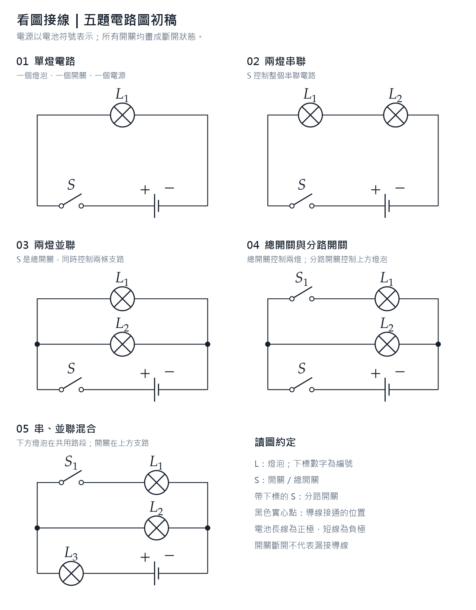

# 看圖接線：DC 固定元件五題活動

狀態：**使用者已批准；活動已實作，驗證紀錄見文末。**
日期：2026-10-29；分支：`codex/circuit-dc-wire-match`。

依 [新活動模板](NEW-SIMULATION-PLAN-TEMPLATE.md) 填寫；共同要求以 [產品基線](00-shared-platform-and-style.md)、[生產合約](../docs/simulation-scorm-production-guide.md)、[電路活動作者指南](../docs/circuit-activity-authoring.md)及 [現行共用架構](../docs/circuit-workbench-architecture-review.md)為準，不在本計劃另建第二套規則。

## 審閱重點與已確認範圍

| 項目 | 本活動決定 |
|---|---|
| 已確認題圖 | 使用者已接受下列五圖；沿用原圖的符號、編號、極性及連接關係 |
| 直接使用 Workbench | **直接載入現有 `CircuitEditor`、model、routing、renderer、solver 等共用原始碼；以 profile 裁剪功能。不是參考後重寫，也不複製一份供新活動獨立維護** |
| 學生工作 | 畫布預置本題全部元件，禁止搬動、旋轉、改名、刪除或另取元件；學生只需取用導線及接線，可操作開關觀察 |
| 五題關係 | 互相獨立，可任意選題；切換保留各題已完成的接線修改 |
| 正確答案 | 比對題圖的端子連接關係，固定電源正負極及元件編號；燈泡與開關的兩端可以對調 |
| 隨機性 | 每題先製作 8 款有無交叉解的固定佈局；新作答獨立抽選，切題及 Moodle 恢復不重抽 |
| 交叉 | 不禁止畫出錯誤接線；提交時扣分。只計最終線形，修正後不追扣曾經出現的交叉 |
| 待審閱評分建議 | 每題 20 分，五題共 100 分；按正確連接關係給部分分，每組交叉扣 2 分，每題交叉最多扣 8 分；合格 80 分 |
| 已批准容量／操作取捨 | 每線長度 1200；各題供應 4／5／7／8／8 條線。新作答 revision 3 使用既有 `wirePointLimit:64`；舊 revision 2 保留 96 點。初版 3 點取捨已撤銷，歷史及最新驗證見文末 |
| 本次交付界線 | 只建立分支、保存已確認圖稿、完成計劃；不改活動核心、目錄、manifest 或執行中的活動 |

## Scope

| Decision | Activity specification |
|---|---|
| Slug／學習目標 | `circuit-dc-wire-match`；讀取標準電路圖，辨認元件順序、干路與支路，在不同位置的實物元件間完成相同接法 |
| 交付 | 一個 SCORM 1.2 SCO，包含五題及一個總成績；亦可用 Live Server 練習 |
| 共用核心／外層 | `CircuitEditor.mount(host, config)` 擁有全部電路操作；新外層只擁有題圖、隨機題面、題號、判分、答案 codec、提交介面 |
| 風險 | `formative`／低風險形成性練習；使用前端判分。本版不作高風險考試的可信評核 |
| 執行依賴 | 現有本地電路 runtime、shared styles／SCORM／activity-flow／fullscreen；題圖用本地 SVG，不新增繪圖或物理套件 |
| 不在範圍 | 新 Workbench、新求解器、任意元件庫、學生自行排元件、自動完成答案、量測題、電流值／亮度評分、後端評分、每人絕不重複的身份分配服務 |

### Catalogue metadata（實作時才加入 `sim/config.js`）

```js
{
  title: "看圖接線：五個基礎電路",
  folder: "circuit-dc-wire-match",
  categories: ["Electricity"],
  description: "根據五幅電路圖，連接隨機擺放的固定元件，辨認接線次序並避免導線交叉。",
  tags: ["physics", "electricity", "circuits", "wiring", "scorm"],
  status: "planned"
}
```

通過可部署 gate 後才改為 `active`；本次文件提交不先建立未能開啟的目錄項目。

## 已確認的五幅題圖



圖稿已從忽略的 `output/` 保存到版本管理範圍：[五頁 PDF](assets/circuit-dc-wire-match/circuits.pdf)、[TikZ 原稿](assets/circuit-dc-wire-match/circuits.tex)。各題 SVG 為最終 Control Panel 圖片的來源；實作時複製資產到活動目錄，不重新設計電路。

| 題目 | 題圖 | 固定元件 | 題意 |
|---|---|---|---|
| 1 單燈 | [圖 1](assets/circuit-dc-wire-match/circuit-01.svg) | B、S、L₁ | 正極 → S → L₁ → 負極 |
| 2 串聯 | [圖 2](assets/circuit-dc-wire-match/circuit-02.svg) | B、S、L₁、L₂ | 正極 → S → L₁ → L₂ → 負極；L₁、L₂ 的編號次序固定 |
| 3 並聯 | [圖 3](assets/circuit-dc-wire-match/circuit-03.svg) | B、S、L₁、L₂ | 正極 → S → 分流；兩燈分別回到負極，S 為總開關 |
| 4 總／分路開關 | [圖 4](assets/circuit-dc-wire-match/circuit-04.svg) | B、S、S₁、L₁、L₂ | S 位於正極干路；S₁ 位於 L₁ 支路、在 L₁ 之前；L₂ 是另一支路 |
| 5 混聯 | [圖 5](assets/circuit-dc-wire-match/circuit-05.svg) | B、S₁、L₁、L₂、L₃ | 正極 → L₃ → 分流；一支路為 S₁ → L₁，另一支路為 L₂，再回負極 |

這裡的箭頭只是教師計劃中讀取連接順序的文字，**不是學生拖線的先後順序**。學生由負極開始拉線、先完成第二支路等都可得滿分。

## 直接使用 DC Circuit Workbench 的方式

### 現有能力與本活動設定

| 現有能力／入口 | 直接使用方式 |
|---|---|
| `CircuitEditor.mount`／`destroy` | 同一時間只掛載目前題目的 editor；切題更換該題的固定 initial document 與 profile |
| `CircuitProfile` | `role:'student'`、`palette:[]`；元件 move／rotate／remove／label／params 全關；只對 switch 型別開放 `switch:true` |
| 接線權限 | `wires:true`、`wireResistance:false`、`undo:true`；端子吸附、拔線、共接、加線、彎線、拉直、刪線、復原／重做沿用現有命令與手勢 |
| 畫布導航 | 保留原有平移、縮放、全圖、桌面雙擊按住拖移、手機雙指導航、接線放大預覽及捲頁把手 |
| 元件檢視 | 預設實物模式；可切換現有符號模式。名稱、L₁／L₂／L₃、S／S₁、電源極性保持清晰 |
| 面板 | 透過已存在的 `panelContent` 放入題圖、要求、幾何提示與提交操作；不另造第二個畫布控制面板 |
| UI 裁剪 | `header:false`、`palette:false`、`settings:false`、`files:false`、`presets:false`、`help:false`、`readings:false`、`probe:false`、`quickParameters:false`、`wireCurrents:false`、`potentialDirections:false`、`playback:false` |
| 無障礙接線 | 保留受權限限制的 inspector／`wireList`，提供現有端點選擇與鍵盤操作；不因隱藏元件工具箱而隱藏必要的接線入口 |
| 外層頂欄 | 使用活動唯一 header，放五題導航、狀態與 shared fullscreen；editor 不產生第二個 header／fullscreen |
| `CircuitActivityRuntime.Controller` | 直接使用已有啟動、保存、導航、check／submit、pending、committed、review 與錯誤處理，不重寫 LMS 生命週期 |
| 題目切換的外層 | 新 `main.js` 接合 runtime 與 editor。舊 `circuit-activity-page.js` 含滑片題／單題元件數的固定假設，不能原封不動用來顯示五幅題圖；只寫本活動頁面組裝，不重寫 editor |

固定元件由 profile 限制，不用把整個 document 改成會同時禁止接線的唯讀模式。權限須在滑鼠、觸控、快捷鍵、公開命令、載入與恢復都成立，不能只藏按鈕。

切題時先取消未提交手勢，保存最後一次正式變更，再卸載舊 editor，以新題的固定 profile 掛載及恢復。不能將不同佈局直接載入舊 profile，否則會觸發固定位置驗證。快速連按導航只可保留最後選定的一個 instance，不得留下舊訂閱或互相覆寫答案。

本版保存每題接線，不保存 undo／redo 歷史；切題後重新建立該題歷史起點。目前題內的復原／重做仍完全使用核心。記錄／凍結後只讀，保留檢視所需的平移、縮放與全螢幕。

### 原始碼與打包界線

開發時直接引用 `../circuit-workbench/` 的同一批檔案。SCORM ZIP 依 manifest 包含這些檔案的副本，是部署產物，不是第二份可獨立修改的原始碼。核心缺陷在共用來源修正一次，不能在活動內包一套替代接線、事件或 solver。

本計劃目前不要求新增 editor API、改路由演算法或改核心預設。所需裁剪均已有配置；如首階段發現真正缺口，先記錄具體證據及所有 consumer，再提出最小共用修正。

## Physics or subject model：判斷連接關係

電源固定理想 6 V，燈泡採既有 ideal／12 Ω／ratedVoltage 6 V，導線 0 Ω。這些是方便觀察的初值，不是評分目標；使用者不能調參。開關初始全斷開，學生可開合觀察，但開合狀態不影響接線分數。

沿用現有 solver 顯示亮燈與短路／過載提示，並在開始處說明：「燈會亮不一定代表與題圖接法相同，請留意電源正負極與元件次序。」不以求解器顯示的亮度、相等電流、可導通或等效總電阻代替題圖比對。

### 權威目標節點

`B+`、`B−` 是電源正負端。對無極性的燈泡／開關，以下 `a/b` 是**本次比對選定的方向**，不是要求學生認出固定左右端；每個元件可以整體交換 a/b。元件身份及編號不可交換。

每個大括號是一組只經導線直接相連的端子；不同組不得被導線短接。元件的內部導通不把其兩端合併，因此開關閉合亦不改變這份接線目標。

| 題目 | 目標端子分組 | 組內兩兩關係數 m |
|---|---|---:|
| 1 | `{B+, S.a}`；`{S.b, L1.a}`；`{L1.b, B−}` | 3 |
| 2 | `{B+, S.a}`；`{S.b, L1.a}`；`{L1.b, L2.a}`；`{L2.b, B−}` | 4 |
| 3 | `{B+, S.a}`；`{S.b, L1.a, L2.a}`；`{B−, L1.b, L2.b}` | 7 |
| 4 | `{B+, S.a}`；`{S.b, S1.a, L2.a}`；`{S1.b, L1.a}`；`{B−, L1.b, L2.b}` | 8 |
| 5 | `{B+, L3.a}`；`{L3.b, S1.a, L2.a}`；`{S1.b, L1.a}`；`{B−, L1.b, L2.b}` | 8 |

以現有 `CircuitChecks.topology(doc).net` 取得導線連通分組，自訂題目比對留在本活動 `scoring.js`。既有 `series()` 不檢查這五題的帶標籤順序，`connected()` 亦不排除額外短接，兩者不能直接當整份 rubric。

比對時列舉每個無極性元件的整體兩端交換；最多 16 組方向，選取正確關係最多的一組，平手採固定順序。**全題只用同一組方向**，不能讓同一燈泡在不同評分項目使用互相矛盾的端子方向。電源正負極永不交換。

三端共接組的任意兩端若已正確相連，可得該關係的部分分；不要求先接到指定「中心端」。例如兩燈的同側端已相連但尚未接總開關，仍保留已完成的共接關係分。可以在元件端子分線，也可以使用真正的中途共接點；導線數量及接線順序不必與示範解相同。

一對端子得分須同時符合：兩者位於同一實際導線節點；該節點的所有**元件端子**都屬於同一目標組。若多拉一條線把不同目標組短接，受影響組的關係不得分，其他未受影響組照常保留分數。

第 1 題必測反例：`B+ → L1 → S → B−` 即使燈亮也不算正確全題；只保留仍成立的局部連接分。這是在評量還原題圖，不是宣稱這個等效電路在物理上不能運作。

## 隨機佈局與可解性

### 產生方法

1. 每題建立 8 個明列的安全佈局，共 40 個。元件種類、身份、數值及題圖固定，只改元件中心位置及 0／90／180／270° 朝向。
2. 第 1 題必須包含燈泡在下方、側邊等變體；其餘題亦改變分支和干路元件的空間配置。初始畫布不能照抄題圖位置，也不顯示答案導線或淡色路徑。
3. 佈局從一個已知的平面接法安排元件，再保留元件、移除答案線；不對元件作任意位置洗牌，不在執行時重試不受限的隨機撒點。
4. 新 attempt 一開始用瀏覽器亂數獨立抽出五個 layout ID，立即納入草稿。題號切換、清除此題導線、Moodle 重進及 viewport 改變都不重抽。
5. 不讀學生姓名／帳號作種子。8⁵＝32,768 種題組可增加差異，但不承諾全班絕無重複；要求「每人必定不同」會是另一個需 LMS 協調的功能。

### 每個佈局的可解證據

每款佈局在測試 fixture 保存至少一份完整正確接法，**用實際核心文件、`CircuitRouting.route()`、題目評分器及 profile 驗證**。不是只檢查抽象圖可平面化。

| 項目 | 驗收界線／初版目標 |
|---|---|
| 元件位置 | 主要中心位置落在約 520 × 360 世界單位的緊湊區域；最終以實際本體、標籤及端點外框驗收，不只量中心距離 |
| 可接線 | 端子朝向可達；元件本體、標籤及其他端子不遮住接孔；不需搬動元件 |
| 路線 | 至少一份滿分解沒有交叉／重疊、不穿過無關元件，所有線及接點均留在可操作範圍 |
| 長度 | 每線預算 1200 世界單位，正確證據中的每線目標不超過 800；不靠用盡線長或沿遠處繞大圈才可解 |
| 彎曲程度 | 證據每線最多 3 個中間點，符合正式 profile；常規繞行路線長度不超過端點直距的 2.5 倍。若端點過近導致此比率不合理，調整佈局，不放寬成任意長線 |
| 庫存 | 每份證據在本題 4／5／7／8／8 條庫存內完成；並聯題包含兩個三線共接點的接法也須可行 |
| 手機 | 320／360／390 px 寬的正式布局驗證端子可選、手指預覽可看、捲頁把手可達；短畫布可沿用縮放定位，不得改動元件座標或答案 |
| 多解 | 除證據解，抽驗不同彎線、從不同端子分支及兩端互換的滿分解；不得只接受 fixture 的線條座標 |

導線「1200」是可拉長的上限，不是新增時在畫布放出 1200 單位長的線；沿用核心目前較短的取線初始形狀及接點旁「＋」快捷取線。

開發階段遍歷全部 40 款，不能只抽幾個 seed。執行時只選已驗證、版本固定的佈局；沒有驗證證據的佈局不進題庫。

## Scoring and tolerance

### 計分建議

每題的連接分 `T = 20 × 正確關係數 / m`，m 見目標節點表。每個無序端子對只計一次，不按實際拉了多少條線加分。每題最後得分：

```text
交叉扣分 = min(8, 2 × 交叉事件數)
題目分數 = max(0, T − 交叉扣分)
總分 = 五題分數相加後四捨五入至整數，範圍 0–100
合格 = 總分 ≥ 80；不設全部訪問／全部完成的額外門檻
```

中間計算保留完整精度；可用 1/168 分為整數單位計算，避免三、七分之一等浮點尾差。介面分項顯示小數一位，明示總分最後取整，不把顯示數字反用來判分。

| 情況 | 處理 |
|---|---|
| 全部未接線、只看題或只切開關 | 0 分；預置元件不算學生答案 |
| 只完成部分連接 | 對每個乾淨目標節點中的已完成端子對給分；其他題不受影響 |
| 正確接線但開關未閉合 | 不扣接線分，沒有「必須亮燈」條件 |
| 燈泡／開關兩端交換、導線起終點反向 | 不扣分 |
| 總開關放到負極側、串聯次序錯、支路開關改控制另一燈 | 依題圖不相符的關係失分，即使通電效果相同 |
| 線只是幾何相交 | 不視作已接通；電氣連接以核心端點／junction ID 為準，另扣交叉分 |
| 冗餘線、未使用／半接的線 | 本身不加分，也不另設超出本需求的用線數懲罰；若形成交叉照扣，若短接錯誤節點則失去受影響連接分 |
| 正確節點內多條等價路徑 | 不重複得分；無額外交叉時接受，避免把示範接線方式當唯一答案 |
| 元件被改名、移動、替換，或 snapshot 結構無效 | 屬違反固定題面／非法狀態，拒絕載入並按技術恢復規則處理，不當作正常接錯線 |

### 交叉的幾何定義

判斷正式文件由 `CircuitRouting.route(doc, wire)` 產生、畫面實際使用的世界座標折線；包含曲線的實際取樣路徑，不以兩端直線或 `via` 控制多邊形代替。相機、縮放、SVG 像素和電流動畫不參與判分。

- 不同導線有一次或多次非法交叉：同一無序導線對計 **1 個事件**，不按取樣段數或同一交點重複扣分。
- 同一導線非相鄰線段的自交／折返重疊：該線計 1 個自交事件。相鄰線段正常相接不算。
- 導線共線重疊，或線端碰在線身但沒有建立真正 junction，亦算走線衝突；單純靠近而未相交不扣。
- 共用同一端子或 junction 的正常匯合不算交叉。豁免只限共同端點附近 **12 世界單位**內的局部匯合；不能因兩條線屬於同一電氣節點，就豁免它們在其他位置的交叉。
- 幾何誤差常數 `GEOMETRY_EPS = 1e-6` 世界單位，僅處理數值誤差；不用 24 CSS px 吸附範圍作扣分距離，也不因手機較窄而擴大扣分區。
- 重疊長度大於 epsilon 才算有長度的重疊；共有端點的鄰域內／外、相交／差一點未碰到、退化短段等都列邊界測試。
- 未接上的散線仍在畫布上，若與其他線交叉也納入；學生可用原生刪線方式收回。

以導線／線段 bounding box 先排除不可能相交的組合；只在正式變更後、還原及提交時計算，不在每個 pointermove 重跑全部檢查。40 款參考解均須通過相同的交叉判斷。

### 作答提示與回饋

作答時可顯示「目前有 X 組導線交叉」及中立位置提示，幫學生理解走線規則；不顯示正確端子、建議接法、拓撲分數或自動修線。此項是明確開放的提交前幾何回饋。

「檢查與提交」只列各題已取線／未接線、交叉數及將提交五題的說明；可返回任何題修改，亦可直接提交空白／部分答案。正式記錄後顯示每題連接分、交叉扣分、未完成或錯接關係。標示「未符合題圖接法」，不以「不能亮」解釋仍能工作的次序錯誤。

## Responsive layout contract

| Decision | Activity specification and reason |
|---|---|
| 三區 | 外層全寬 header；Workbench stage；其既有 panel 內的活動內容。題號導航不塞入可捲動 panel |
| 桌面／平板 | 沿用 editor 的 stage＋panel 結構，活動範圍 CSS 將 panel 目標寬度設為 320 px（可在 300–360 px 調整）；保留足夠接線畫布 |
| 手機斷點 | 760 px 以下 stage 在上、panel 在下；這是持續邊看題圖邊接線的 `bounded split-panel` |
| 題圖位置 | panel 最上方顯示本題完整 SVG，其次短題意、交叉提示、原生接線檢視及提交控制；圖形保持原比例，不讓水平捲動成為看圖前提 |
| 圖片文字 | 外層標題及替代文字為繁體中文；SVG 內的數學編號已轉向量。提供等價可讀的連接關係文字描述，供輔助技術讀圖 |
| 短 viewport | header 換行而非遮擋全螢幕；stage／panel 的有限高度按可用空間分配，panel 自己捲動。必要時使用已有全圖／放大，不縮小 44 px 操作目標 |
| 全螢幕 | 外層 main 使用 `data-sim-fullscreen-target`，header 使用 `data-sim-fullscreen`，載入 shared fullscreen。涵蓋題號、圖、canvas、提交；editor `ui.header:false` |
| 字型／符號 | 外層文字 16 px，次要文字不小於 14 px；必要圖標籤實際手機尺寸不小於 14 px。沿用 shared system UI／math stack，使用真正下標 |
| 版面核對 | 320×568、360×740、390×844、844×390、1024×768、1440×900、640×360 短 iframe，加 200% zoom、工具列高度改變及旋轉 |

現有 `circuit-activity.css` 是舊的自然頁面流外殼，不直接用其高度規則覆蓋這份 bounded layout。活動 `styles.css` 只調外層與本活動 host；不要改教師三工作台的預設排版。

## Navigation, submission and reset

- 題號 1–5 永遠是獨立導航。只顯示目前題／未接線／已有操作等中立狀態，不預先標對錯。
- 每個可編輯題都能進入同一個最終檢查頁，毋須做完或看過其他四題；不在第 5 題自動交卷。
- 可提供「清除此題導線」，只清當前題的線及自由接點，保留固定佈局、其他四題及本題開關狀態；非空時說清影響並確認。由活動外層載入同一 profile 驗證過的空線文件，不新增核心 reset 機制。
- 題內 undo／redo 不跨題；清除此題導線後重新建立編輯起點，UI 不暗示可跨清除還原。
- 已記錄結果與 pending 不提供清除、重做或重抽題面；Moodle 新 attempt 才建立新一份正式作答。Standalone refresh 則依共同合約重新開始空白練習。
- 進入 check、切題、pending、review 前取消拖曳／預覽，不把滑鼠放開前的暫態位置混入提交。

## Phase/state matrix

答案內只保存 `phase:'edit'|'check'`；review／frozen／committed／technical 等模式由共用 runtime 的 attempt／submission 結果決定。

| Phase／variant | 必要語義狀態 | 合法未答與保留內容 | 還原後必須執行的續作測試 |
|---|---|---|---|
| 新 edit | 五個有效 layout ID、question 0–4、五題空線文件 | 全部未訪問合法；開關初始斷開 | 選第 5 題取線，再進 check |
| edit：空白但切過題／開關 | 各題 layout、view、switchMask 保留 | 沒有線仍是 0 分 | 加線或直接交空白卷 |
| edit：部分接線／懸空線／共接 | 五題各自的 wires／junctions，當前題正確 | 其他題可全空；接錯／交叉是合法答案 | 拔線、移線、接至另一端，再保存 |
| edit：正確／次序錯／交叉 | 同一 schema，各答案由正式 UI 操作產生 | 不用得分或完成旗標控制合法性 | 切題再返回，線形與分數不變 |
| check：空白／部分／完整 | phase check，保留全部五題及當前題 | 不要求 all-visited 或 all-correct | 返回指定題修改，或明確 submit |
| check 返回 edit | phase edit，其他題資料仍在 | 不能清掉未開啟的題 | 改一條線，再次 check／submit |
| pending-final／frozen | 有效 review JSON 及原樣 payload；答案凍結 | 可看五題，不能更改線、開關或重抽 | 切換只讀題圖後重試原 payload，內容逐字不變 |
| review／committed | 全五題權威答案可解碼及重算，或可信 LMS 摘要 | recorded 只讀；committed 僅重試 finish | 查看另一題、移圖、全螢幕；嘗試接線被拒絕 |
| invalid draft | 固定題面、引用或編碼無效 | 保留原持久資料，technical 禁寫 | 顯示讀取問題，不能自動覆蓋成新題 |
| invalid pending／finished mismatch | 不可信答案不能重新評定為有效 | pending quarantine；finished 僅可信摘要 | pagehide／BFCache 不重送拒絕的成績；不能重開編輯 |

## Persistence contract

### 保存策略與明確容量取捨

五題放同一 SCO，所以 **4000 UTF-8 bytes 是整份 attempt 的上限，不是每題各 4000**。普通 v6 document、五張截圖或五份既有單題 JSON 都不適合直接保存。

初版採用現有 `wirePointLimit:3`，線形與端點依原核心在 preview／正式 history 時受同一限制。仍保存 Float64 原值，不在存檔才四捨五入、不把曲線換成另一條線、不加入新的粗網格吸附。這項設定會降低自由線形的細節，是第一個實作驗證 gate；若彎線手感或路線不合格，必須先重新設計容量／庫存方案，不能以失真的恢復或超額 pending 交付。

固定元件由「活動 revision＋題號＋layout ID」重建；保存學生可改的導線、自由接點、開關及檢視。所有 layout 的元件順序與身份在 revision 內固定，不能在日後改表後默默重解舊答案。

### 權威 schema

```js
answer = {
  revision: 1,
  phase: "edit" | "check",
  question: 0 | 1 | 2 | 3 | 4,
  answers: [base64Q1, base64Q2, base64Q3, base64Q4, base64Q5]
}
```

`answers` 必須恰好五項，即使未訪問亦保存該題的空線狀態及 layout。沒有 `null` 猜測、不以缺欄位代表未答；合法未答是 wireCount＝0、junctionCount＝0，switchMask 可由學生操作而不同。

每題二進位 payload（固定 little-endian；全部欄位必須剛好消耗，不准尾隨資料）：

| 欄位 | 格式／界線 |
|---|---|
| header | 5 個 Uint8：`layoutId` 0–7、`view` 0/1、`switchMask`、`junctionCount`、`wireCount` |
| switchMask | 按 spec 的固定開關順序，每個一 bit；只有本題存在的 bit 可為 1 |
| junctions | junctionCount 組 `(x,y)`，每值 IEEE754 Float64，共 16 bytes／點；只允許有限值與核心座標界線 |
| wire header | 每線 4 個 Uint8：`fromRef`、`toRef`、`shape` 0/1/2＝auto/free/smooth、`viaCount` 0–3 |
| via | viaCount 組 `(x,y)`，每值 Float64；原值無損保存 |
| 端點引用 | 元件以 spec 順序的兩端編為 0 至 2C−1；junction 自 2C 起編號。必須存在、合法；最大範圍遠小於 256 |
| 固定導線資料 | 每線 length＝1200、resistance＝0，由本題配置重建；capture 驗證相符，不能任意略去一個可變值 |
| 數量界線 | 線最多 4／5／7／8／8；自由接點最多兩倍線數；每線最多 3 中間點；拒絕未引用的自由接點 |
| 派生 ID | 恢復時重建 c／j／w ID；引用索引是權威關係，驗證索引，不把任意產生的 ID 字串當答案 |

profile、palette、固定元件座標、參數、答案目標、扣分規則均來自可信本地 spec，不從 snapshot 匯入。restore 順序為解碼／邊界驗證 → 生成對應固定題面 → 重建線 → `CircuitModel.validate` 與正確 profile 的 `assertSnapshot` → 重算連接及交叉 → 掛載／還原並依 mode 鎖定。

| 資料類型 | 處理 |
|---|---|
| 權威 | 五題 layout、所有線端關係／線形、自由接點、開關、view、phase、question |
| 派生 | 端子世界座標、實際 route、net、交叉集合、分數、題目進度與 DOM |
| 暫態 | 相機、拖曳、hover、選取、放大預覽、動畫、undo／redo、fullscreen；不保存 |
| 版本 | revision 1 只接受本版 schema／佈局／判分；未實作的版本明確拒絕，不偷用新佈局重解 |

### 容量預算與驗證要求

以全部 32 條庫存都用盡、每線兩個獨立懸空端點、每線 3 個中間點估算：每題二進位最多 `5 + W × (4 + 16 × (2 + 3))` bytes，分別 base64 後放入上列 answer。

2026-10-29 用現有 shared envelope／pending 欄位的 JSON 形狀計算：最大 answer **3694 bytes**，review **3794 bytes**，pending-final **3970 bytes**。這是**格式上限試算，非正式 codec 或合法 production fixture 已通過**；餘量僅 30 bytes，payload 不再隨便加入提示文字、分數明細、種子或額外旗標。

實作必須用正式 capture／encode 產生最壞合法 draft、review、真正 `reviewJson` 巢狀 pending，斷言每個都 ≤4000。不能假定普通 JSON 字數等於 UTF-8 bytes；不能只測全部線已連好、接點很少的答案。測試完整碼流、base64 canonical encoding、非有限座標、錯誤索引、數量超額、非法 switch bit／view／shape／revision 及額外欄位。

對所有 phase／variant 都執行 `score(state) === score(restore(encode(state)))`，另比較交叉事件、實際 route 與 legal continuation。不可只驗證解碼成功。

## Shared SCORM lifecycle

直接使用共用 `CircuitActivityRuntime.Controller` 接合 `SimScorm.loadAttempt()`、`SimActivityFlow.startup()`、draft provider、`submitWithCallbacks()` 及 `SimActivityFlow.submission()`；禁止本活動另寫 raw LMS 欄位、commit／finish 或 page lifecycle。

| Outcome／policy | 本活動顯示及操作 |
|---|---|
| editable | 還原五題，按保存 question 顯示；新 attempt 才抽 layout |
| review | 解碼全部答案並重算，交由 `reviewResult` 與 saved／LMS 核對；成功才顯示詳細成績 |
| frozen | 五題保持凍結；只讀切題不修改 finalSnapshot／payload；可重試同一份提交 |
| load-error／invalid draft | 技術鎖定，保留原資料，不重抽覆蓋 |
| success | 顯示已記錄成績，全部 review-only |
| committed | 已記錄但結束未完成；只允許 retryFinish，不重新送另一份成績 |
| retry：可重試 | 保留答案，依 runtime 回到 check 可修改／重試；不冒稱記錄成功 |
| retry：不可安全重試 | 技術鎖定；不自行清結果 |
| invalid pending | quarantine 後禁重試，避免共用 pagehide 再送錯誤成績 |
| Standalone | 純記憶體；refresh 後五題空白並可重新抽 layout；忽略舊 checkpoint，storage 被拒絕亦可用 |
| Moodle | 同一次 attempt 恢復相同 layout／接線／階段；新 attempt 才換新題面 |

## Touch gesture ownership contract

沿用 [生產合約的手勢要求](../docs/simulation-scorm-production-guide.md#selective-touch-gesture-ownership)及現有 Workbench 的命中、捕獲與預覽。不得為加入題圖、交叉提示或結果標記覆蓋一層全畫布互動元素。

| Target／mode | 視覺／命中與 owner | 必測／鍵盤替代 |
|---|---|---|
| 固定元件本體 | 使用既有 body hit，但 profile 禁 move／rotate／remove | 拖曳、R／Shift+R、Delete、複製與命令均不改元件；不可把「固定」當作已完成觸控驗證 |
| 端子／線端／共接點 | 原有 44 CSS px 局部目標；原生穩定 capture | 接上、拔開、共接、拆開全部、接點旁＋；既有鍵盤接線／端點選擇 |
| 線身／彎線把手 | 原線形命中與拖動；當前工具擁有必要的繪線區 | 拉彎、拉直、整線、刪線、undo／redo；拖動時所有頁面／iframe owner 不動 |
| 開關 | 只允許原生開合，不搬元件 | 點擊／鍵盤開合、狀態保存；同一答案開／合評分相同 |
| 空白與左右把手 | 非繪線空白及可達把手歸 enclosing host；coarse pointer 保留現有 32×64 px 把手，含混合裝置 | 上下滑、快 flick、boundary、release 後慣性；既有 camera mode／雙指不改答案 |
| 題圖／說明／panel | 原生 panel 捲動；圖非拖曳物件 | 首尾邊界與快速滑動不誤接線；題圖放大／說明焦點可返回 |
| check／review／frozen | 同一 host 規則；不允許答案操作 | 只讀移圖／放大／切題／fullscreen；其餘 mutation 被拒絕 |

接孔吸附沿用核心 **24 CSS px**、實際端子／接點優先與 release 相同位置；不吸到正確答案路線。手指會遮住接線端，所以保留核心實景放大預覽，不額外實作；須驗證預覽沒有覆蓋目標、題圖和其他必要操作。

| Host | 所需驗證 |
|---|---|
| T0 standalone | 實際頁面 owner；bounded 活動 document 無多餘可捲範圍，stage／panel 分工 |
| T1 direct iframe | 外層 window owner；活動內操作與 host 捲動互不搶佔 |
| T2 nested player | 外層可捲頁與中間有界 frame；不能只假定 parent 就是 owner |
| T3 overflowing element | 指定外層 scroll element；記錄正確 owner 的 scrollTop |
| T4 real Moodle | 真實 Moodle player offered current/new-window 模式、iPhone Safari／Android Chrome；獨立部署 gate |

source 與解壓 package 在 T0–T3 執行：五題、不同端子朝向／支路位置的代表佈局、空線／部分／交叉／完整、drawing／pan、check-return、review／pending、real／schematic。全部 40 佈局另遍歷端點 hit／截圖及無交叉完成路徑；若其命中幾何產生額外手勢種類，補可信觸控案例，不能只以同一 profile 作等價理由。

每次拖移記錄 per-move／release、所有 window／element／iframe 位置、答案不變條件；共同要求中的兩方向、panel 首尾、快 flick、pointercancel／第二指及旋轉中斷都要覆蓋。真機未測就保持待驗證。

## 實作涉及的檔案與現有 consumer

| 位置 | 預期工作 |
|---|---|
| `sim/circuit-dc-wire-match/index.html`、`styles.css`、`main.js` | 活動外層 header／panelContent、五題圖、單一現成 editor、runtime 接合及可存取訊息 |
| 同目錄 `spec.js` | 五題固定元件、目標節點、庫存、profile、版本、40 個已驗證 layout；不另建通用題庫框架 |
| 同目錄 `scoring.js`、`crossings.js` | 題圖特定比對與部分分；實際線形交叉幾何。評分規則留在活動，不加入 DC solver |
| 同目錄 `persistence.js` | 五題 Float64 無損二進位 codec、profile 驗證與權威狀態；重用現有 envelope／bytes 工具 |
| 同目錄 `assets/circuit-01.svg` 至 `05.svg` | 已確認題圖；題圖的替代文字由外層提供 |
| `sim/manifests/circuit-dc-wire-match.xml` | 全部活動檔、實際引用的 shared／DC 核心及本地 MathJax 等依賴 |
| `sim/config.js` | 唯一 catalogue 項目 |
| `tools/package-circuit-platform.js` | 把第三個 DC SCORM 納入；其專用檔案／SVG 不能被現有固定單題清單覆寫掉。仍以 `runtime-assets.json` 為共用依賴來源 |
| `tools/test-registry.js` | 新邏輯測試、browser owner、helper consumer；circuit-family 相鄰回歸 |
| `docs/circuit-activity-authoring.md`／架構圖 | 活動實作後才補第三個 DC SCORM consumer／六包交付物的真實狀態；不預先宣稱完成 |

核心若不用改，保留其所有來源原樣。若驗證發現需通用修正，影響範圍包含 DC／AC／家庭三工作台、兩個既有 DC SCORM 及本活動；檢查所有 caller、profile、fixture、runtime 清單與包內同源性，不只測新活動。

## Test plan

### 邏輯與 production fixtures

- [ ] 五題全部標準接法、各元件兩端互換、電源正負極不可交換、L₁／L₂ 次序錯、S／S₁ 控制位置錯。
- [ ] 全空 0 分、只開關 0 分、每種部分共接得分、錯誤短接只失受影響組、冗餘線不多得分；總分取整／80 分界線。
- [ ] 相同亮燈／電流但不符合題圖的反例，保證不是 solver 等效性評分。
- [ ] 交叉、重疊、端碰線、自交、合法共接、相同 net 在別處交叉、共同端點 12 單位邊界、epsilon 邊界、曲線與直線判斷差異、同一對多次交叉不重複扣。
- [ ] 改變相機、viewport、view 及 switchMask 不改接線／交叉分；完整修正交叉不保留歷史扣分。
- [ ] 全 40 layout 的正式 profile、無交叉滿分解、庫存／長度／3 點限制、標籤與端子可達；抽樣 alternate solutions。
- [ ] 每個 phase／variant 的 production encode/decode/restore 與一個實際合法續作，五題切換不漏存；最壞草稿／review／pending ≤4000。
- [ ] 非法欄位、非 canonical base64、截斷／尾隨 bytes、非有限座標、錯誤 endpoint、超庫存、非法 layout／版本／switch bit、被改固定元件；draft／pending／finished 各自安全處理。
- [ ] 真共用 runtime 的 startup／success／committed／frozen／retry、儲存失敗、review trust mismatch、pending quarantine、只讀切題不改最終 payload。

### Browser／source 與 package

- [ ] 可信滑鼠與觸控完成取線、快捷取線、拔線、接合、彎線、共接、復原；固定元件所有修改入口被拒絕，沒有元件工具箱。
- [ ] 每題能任意選擇、保存、返回；快速切題／拖動中切題沒有失去最後正式修改、事件殘留或多個 editor。
- [ ] 五題任一處可直接 check／提交全空或部分；pending／recorded 無清除、重抽、再編輯入口。
- [ ] 題圖手機可讀、標籤不遮擋、panel 最後控制可達；40 佈局的端點／圖像檢查及適用手勢矩陣通過。
- [ ] source／extracted package 各自測 standalone refresh（含舊／損壞 checkpoint、禁止 storage）及 Moodle mock 同 attempt 恢復。
- [ ] shared fullscreen 真 click/tap 進出、Esc／外部退出、拒絕／不支援、pending／review 中可達，答題資料與 SCORM 連線不變。
- [ ] T0–T3 全部適用手勢矩陣與 console／network 檢查；使用專案文件指定的 Windows Git Bash 路線，輸出有 `### Error` 即失敗。

### Test registration and CI selection evidence

| Item | 規劃／證據狀態 |
|---|---|
| Node entries | 本活動 `scoring.test.js`、`crossings.test.js`、`layouts.test.js`、`persistence.test.js`、`lifecycle.test.js`；都加入 registeredTests |
| Browser owner | `tools/circuit-wire-match-browser-regression.js`，`kind:'browser'`、`scope:'circuit-family'`；同一 driver 執行 source／extracted package |
| Helpers／fixtures | 優先測試內明列合法 fixtures；若抽成 `*-browser-cases.js`，登記 file、scope、真實 importing consumer；不建第二份執行清單 |
| 資產 | manifest 驅動 reverse consumers；本活動是 SCORM，不另造 standalone assets.json |
| 相鄰 consumer | 既有 `circuit-assessed-browser-regression.js` 及受影響的 DC／AC／家庭 suites；共用修正按 registry 選擇完整範圍 |
| `check:tests` | 待實作後執行；本次只寫文件，沒有新增可執行測試 |
| committed selection preview | 待有實作 commit，以真 base/head 跑 `npm run test:affected -- --base=<sha> --head=HEAD --plan`；catalogue／registry 變更預期 full scope |
| CI run | 尚無新活動執行證據；需記錄測試 SHA、run URL、選擇範圍及成敗 |
| 分離人工 gate | 真 Moodle／真機 T4 尚未執行；如建立獨立部署 runner，按規則登記 manualBrowserTests 及理由，不用來減免正式 browser 測試 |

## 實作順序與停止條件

1. **先審閱本計劃**：確認題圖順序判準、評分／交叉定義、隨機方式、開關可操作與 3 點線形容量取捨。本次在此停止，不先寫活動。
2. **最小可用接線樣板**：直接 mount 現有 DC editor，用固定元件及 panelContent 展示第 1／4／5 題；驗證裁剪權限、取線／彎線手感、3 點限制、1200 線長與最壞正式 pending 容量。若未達要求，不擴充五題 UI。
3. **40 佈局與判分**：完成全部 layout 的實際無交叉證據、所有目標節點及方向比對、交叉與邊界測試。未有證據的變體不加入。
4. **五題外層與保存**：整合現有 runtime、任意切題、空白／部分 check／submit、全部 phase round-trip、只讀與 pending 原樣重試。
5. **版面與可信輸入驗證**：手機／短 iframe、題圖、T0–T3、fullscreen、source／package；修正問題後才標 package-ready。
6. **部署驗收**：真 Moodle 學生帳號與實體手機 T4，獨立記錄後才標 Moodle-ready。

## Package-ready checklist

- [ ] 本計劃的 rubric、40 佈局、所有 schema／phase 及合法續作均有正式證據。
- [ ] 每線 3 中間點的手感／線形品質可接受，所有正確路線可操作且交叉判斷與畫面一致。
- [ ] 最大 draft／review／真實 pending-final ≤4000 bytes；無精度流失或存檔後變形。
- [ ] 來源／解壓包 browser、T0–T3、fullscreen、固定元件權限及所有提交結果通過。
- [ ] `npm run check`、`npm test`、`npm run check:tests`、`npm run package:all`、擴充後的 `npm run package:circuit-platform` 通過；記錄範圍與輸出。
- [ ] 新 ZIP 根層有 imsmanifest.xml；三個 standalone＋三個 DC SCORM 共六包依賴／同源檢查通過；沒有測試或繪圖建置檔意外打包。
- [ ] 實作 commit 的 selection-preview／CI 證據、`git diff --check` 及真實 base diff 審閱完成。

## Moodle-ready checklist

- [ ] Package-ready 全部完成。
- [ ] 真 Moodle 同 attempt 的隨機題面與五題接線恢復；全空／部分成績、pending retry、記錄後只讀、Moodle 新 attempt 的新題面均驗證。
- [ ] iPhone Safari／Android Chrome 的實際 player、T4 全 phase／mode 及適用 gesture 矩陣通過，含快速滑動、panel 邊界與欄位不遮擋。
- [ ] 保存／提交失敗的畫面沒有誤稱已記錄；實際執行日期、版本、裝置與證據列入本節。

## 本次文件階段紀錄

- 已從 `main` 建立 `codex/circuit-dc-wire-match`。
- 已查閱現有 profile、editor／routing、checks、兩個 DC SCORM 的 runtime／page／codec、package builder 與 test registry，據此區分可直接使用能力與本活動外層。
- 已保存使用者確認的五幅 SVG、總覽、PDF 及 TikZ 原稿；未修改其電路內容。
- 已完成上列 4000-byte 格式試算；尚未實作 codec、隨機佈局、交叉判定或執行其 production tests。
- 所有活動實作、package-ready、Moodle-ready checkbox 保持未勾選；現有其他活動的歷史測試不是本活動通過證據。

## 實作與執行紀錄（2026-10-30）

- 直接使用同一 `CircuitEditor` 及 `CircuitActivityRuntime.Controller`；未修改共用 editor、profile、routing、renderer 或 solver。現有手機預設收面板由活動掛載後啟動原有面板按鈕展開，沒有另寫面板控制。
- 已實作五題、8 款／題（旋轉、反射、緊湊間距變體）、固定元件、題圖、分項評分、交叉提示、五題自由切換、清除此題導線與 SCORM 提交。沿用原工作台操作。
- 40 款正式核心文件均通過固定 profile、無交叉滿分解、每線 ≤800 及精確路線恢復。參考線不進 SCORM 套件；fixtures 僅供測試。
- 正式 codec 的最大合法 32 條散線／64 自由端點／每線 3 中間點，真實 pending-final 3970 bytes；全精度 round-trip 與合法續作通過。
- 正常操作可將導線兩端接到同一節點；codec 接受此類核心允許的錯誤接線，不讓學生操作導致技術錯誤。它不額外增加關係分，自交照幾何規則處理。這修正了計劃中將 self-loop 一律當作非法 snapshot 的過窄限制。
- 已修正並加測：共同端點之外的共線重疊不可被端點豁免吞掉。
- 新 browser owner 為 `tools/circuit-wire-match-browser-regression.js`；現有兩個 assessed consumer 的 driver 保留其原題型測試，新增活動由自己的 driver 處理。
- `npm run check:tests` 通過：285 entries（246 Node、39 browser），48 helpers、2 manual。`npm run check` 通過。
- `npm run package:all` 已通過全部套件檔案／manifest 核對；`package:circuit-platform` 已建立六包並通過來源一致性。
- 本活動五份 Node 測試通過：layouts、scoring、crossings、persistence、lifecycle（使用真正 shared SCORM runtime）。完整專案 Node／browser 回歸執行狀態另記下方；不以本活動測試代替全部回歸。
- 產物：`output/circuit-dc-wire-match-scorm.zip`。來源入口：`sim/circuit-dc-wire-match/index.html`。
- 真 Moodle 學生帳號、iPhone Safari／Android Chrome 實體裝置、T4 均未提供環境，保持未驗證。

### 新活動瀏覽器實測

`node tools/circuit-wire-match-browser-regression.js` 已通過來源及解壓 SCORM：七種視窗尺寸各自空白提交、各 40 款已答佈局恢復、真實觸控取線／拖線吸附與 undo、全螢幕、滿分凍結／重試／只讀重進、standalone refresh。

另執行 96 個 T1–T3 host 案例（source／package × 三種 host × 第 1／5 題 × real／schematic × edit／check／review／frozen），左右把手分別用可信觸控滑動，核對 per-move 單調捲動、正確 owner、活動 document 不捲、答案不變。Evidence：`output/playwright/wire-match/evidence.json`，110 個摘要案例，0 個 runtime exception；各題 screenshot 在同目錄。

此證據不等於所有部署手勢矩陣已通過：T4 真 Moodle／真手機、所有編輯 target 的完整 phase／interruption 矩陣及 200% zoom 等仍保持未驗證。完整專案回歸結果未出前，不標 package-ready 或 Moodle-ready。

### 最後修正及回歸範圍

- 增加連續切題 6 次的 browser 測試，修正尚在掛載時重複 mount 同一 host、面板離開 DOM 時引用失效的競爭。掛載依序執行、丟棄過期掛載並保留外層 DOM 引用；不改 Workbench 核心。
- 此修正後重新打包六包，重新執行本活動 source／package 全部 browser 案例並通過。
- 全部 246 個 Node entry 已有通過證據：四分片 245 項通過；`tools/ci-prepare.test.js` 在分片的 120 秒界線超時，後以允許建立 Git fixture 的獨立執行重跑通過。不能把四分片報告說成全部一次通過。證據：`output/wire-match-node-shards/*/report.json` 及 `output/wire-match-ci-prepare.log`。
- `npm run check` 最後一輪通過，`git diff --check` 通過。
- 初次 committed selection-preview：base `0fc1d30922de42aeb7a9ad3ec3efdd24972c89c5`、head `40599510035c927d5c0bb116fcb6cdd9ee9482dd`，結果 full／285 entries，包含本活動五個 Node entries 及 browser owner。原因為共用生產文件／基建與 catalogue／registry 範圍；最新完整分支範圍的輸出保存於 `output/wire-match-selection.json`。
- 全套 `npm test` 的瀏覽器部分仍執行中，進度見 `output/wire-match-full-tests.log`；尚無全部通過結果或 GitHub run URL，不標 package-ready。上述部署矩陣未執行項目亦保持未勾選。
- 本地試用 server：`http://127.0.0.1:10431/circuit-dc-wire-match/index.html`（僅在目前電腦啟動期間可用）。

## Sites 部署（2026-10-30）

使用者要求部署至 Sites，已建立本活動獨立 owner-private Site；沒有覆寫三個工作台或主目錄 Site 的 project ID／audience。

| 項目 | 部署證據 |
|---|---|
| 網址 | https://simlab-dc-wire-match.ieyp.chatgpt.site |
| Project ID | `appgprj_6ae3d4154a488191b9f9fca18a8b4900` |
| Sites source commit | `c8f3850ed2bd6d6a98a6b5758118152638a7140a` |
| Saved version | `appgprj_6ae3d4154a488191b9f9fca18a8b4900~appgver_e132c0948a648191a590498123e3ab32` |
| Deployment | `appgdep_6ae3d46eeb3c8191ba20e0b298d83a7d`，原生工具回傳 `succeeded` |
| 存取 | owner-private，需要擁有者帳號登入；沒有變更成公開學生入口 |
| 來源／封裝 | `output/sites/circuit-dc-wire-match-source`；`output/sites/circuit-dc-wire-match.tar.gz` |

以活動 manifest 的 37 個 runtime 檔案準備 buildless dist，與已測試來源逐 byte／SHA-256 核對；另加 root redirect，保留 query/hash。官方 helper 推送來源及封裝，原生私人 save-and-deploy 成功，並已在 Codex 開啟站點。部署紀錄為 `output/sites/circuit-dc-wire-match-deployment.json`。未上載測試、fixture 或其他工作台入口。

Sites 是 standalone 練習，刷新全新開始；不代替 Moodle SCORM 成績回傳。沿用已通過的來源／解壓 SCORM browser 證據，本次沒有重跑線上 browser 或真 Moodle／實體手機驗收。

### 全專案回歸更新

先前背景 `npm test` 已完成：282／285 通過。本活動 browser 通過；失敗 entry 為 `tools/rocket-space-mission-browser-regression.js`、`tools/circuit-household-browser-regression.js`、`tools/free-fall-stroboscopic-browser-regression.js`，未在本次 Sites 部署範圍內修復。報告：`output/ci-tests/local-1793291018594-7752/report.json`。因此不能把此次部署或本活動專項通過說成完整專案 gate 已通過。

## 修訂 2：恢復原生彎線與完整保存（2026-10-30，取代前述 3 點／4000-byte 方案）

使用者指出尖角與原 Workbench 不同，並選擇「Sites 和 SCORM 的完整保存方案一併重做，再發布」。故撤銷每線 3 個中間點的設計；活動使用未修改的原生彎線及預設 96 點，不另作平滑、取樣、量化或存檔時變形。

**新的交付範圍：SCORM 1.2 API + Moodle 擴充 suspend-data 容量（64000 bytes）。** 這不是可在嚴格 4096 字元 LMS 使用的通用包。部署前須由 Moodle 管理員確認 Site administration → Plugins → Activity modules → SCORM package 的「Enable SCORM 1.2 standard mode」關閉；沒有授權或工具連線修改真 Moodle。本項是具名的活動容量例外，其他活動仍以 4000 bytes 為上限。

依據：[Moodle 官方設定文件](https://docs.moodle.org/en/SCORM_settings#Other_Important_Settings)、[Moodle 4.5 設定來源（scormstandard）](https://github.com/moodle/moodle/blob/MOODLE_405_STABLE/mod/scorm/settings.php)。原本用削減線形配合容量的做法不再保留。

### 修訂 schema 與容量證明

- answer revision 2；仍為 phase、question、五項 answers。各題二進位欄位、Float64 little endian、固定元件重建、端點索引關係保持；每線 viaCount 可到原核心 stroke 上限 96（auto 仍受核心 bends 24），不改已畫出的實際座標。
- 二進位改用 JSON-safe Base85（85 個可列印 ASCII 字元，不含雙引號或反斜線），每 4 bytes 對應 5 字元。末組補零但解碼時按正式結構及 canonical 重編碼驗證，不接受多餘尾部、非法字元或 overflow。
- 32 條線、64 個獨立自由端點、每線 96 個 Float64 中間點共 50,329 raw bytes；各題分組編碼後約 62,920 ASCII bytes，另加 draft／review／pending 封套仍低於 64,000 bytes。以正式 codec 與真 shared runtime 的最壞合法作答測試實際值。
- revision 1 不自動改寫：舊 Moodle draft 保持 technical lock，舊 finished 僅可信摘要；新包應由 Moodle 新活動／新 attempt 開始。Sites refresh 本來即全新練習。
- shared SCORM 增加受信任、僅初始化前可選 4000／64000 的容量設定；預設 4000。活動外層與 decoder 必須採同一上限；不能由作答資料自行加大。提交仍完全經現有 shared lifecycle。
- 嚴格 LMS 拒絕大 payload 時，保留當頁答案、顯示未保存、禁止正式提交；不得縮短曲線或顯示保存成功。pending／review／retry 原樣與既有 trust contract 保持。

### 必驗案例

1. 同一核心拉線動作經 teacher profile 與本活動 profile 的文件、96 點及實際 route 完全一致；重複拉彎、端點固定、undo／redo、切題與恢復不變形。
2. 自由曲線、曲線交叉／不交叉、自交、共同端點；score／crossings 在 encode/decode 後一致。
3. 32 條原生 96 點線的真正最大 draft／review／pending ≤64000；所有浮點位元及端點關係無損。
4. 模擬 64000 與嚴格 4096 上限的 LMS；大草稿、same-attempt reload、pending retry、submitted read-only、save error 與 standalone refresh。
5. 原有 4000-byte SCORM 活動與 runtime 測試維持通過。重建引用 shared runtime 的套件並登記新測試。
6. 先完成 source／extracted package 的可信拖線與上述保存測試，再更新同一私人 Sites project；不先發布僅外觀修正。

### 修訂 2 執行結果

- 已移除 `wirePointLimit:3`，使用原核心預設 96，沒有修改 routing、bend、renderer 或教師工作台。新 `native-wire.test.js` 驗證 40 佈局 × 4 次拉彎，活動／教師的線形完全相同，保存／恢復後 route、crossings 與分數一致。
- Base85／Float64 codec revision 2 實測最壞 pending **63276 bytes**。非法字元、overflow、尾隨資料、canonical encoding、revision 拒絕及完整精度均驗證。
- 真 shared SCORM runtime 的最大答案 draft／reload／pending／retry／review 通過；嚴格 4096 字元 mock 拒絕時保留當頁答案、顯示未保存且無法提交；舊 revision 1 草稿／已完成結果保持鎖定，不覆寫。
- 來源及解壓 SCORM browser 通過：既有 110 個摘要案例，加桌面／390px 真觸控彎線、undo／redo、切題與 reload 線形逐值相同，以及最大答案凍結／retry／review、嚴格 LMS 拒絕；共 116 個摘要案例，0 個 runtime exception。圖：`output/playwright/wire-match/{source,package}-native-bend-{1280,390}.png`；完整證據 `output/playwright/wire-match/evidence.json`。
- Shared `scorm.test.js` 預設 4000／明確 64000 邊界及初始化後禁止修改通過；兩個原有 DC SCORM 的 `assessed-activities.test.js` 通過。新增容量只由可信 spec 選取。
- `check:tests` 通過（286 entries／247 Node／39 browser）；`npm run check`、`npm run package:all` 及六包 `package:circuit-platform` 均通過。ZIP 另包含教師 `DEPLOYMENT.md` 說明容量需求。
- 完整全專案回歸未在此修訂重跑；先前其他三個活動的 browser 失敗仍未處理。真 Moodle、其容量設定、真手機 T4 仍需部署環境確認，不標 Moodle-ready。

### 修訂 2 已發布至原私人 Site

- Sites 原生發布回傳 `succeeded`：https://simlab-dc-wire-match.ieyp.chatgpt.site 。保持 owner-private，未變更 audience。
- SimLab runtime commit：`b1337d47c86ca2312b17d827f989ee8591a54e01`；Sites source commit：`91855b3f92819435d9a0a739c9d063423b6d3d7a`。
- Saved version：`appgprj_6ae3d4154a488191b9f9fca18a8b4900~appgver_d102c36fe29c8191a35e326c038021f8`；deployment：`appgdep_6ae3da0a3de4819190864ee1a3ac14e0`。
- 38 個部署檔案與已測試來源逐 byte 核對，證據 `output/sites/native-wire-assets.json`。官方 helper 完成來源推送／封裝，archive 為 `output/sites/circuit-dc-wire-match-native.tar.gz`；部署及 SHA-256 紀錄為 `output/sites/native-wire-deployment.json`。
- 修正後 SCORM 包：`output/circuit-dc-wire-match-scorm.zip`，包含 `circuit-dc-wire-match/DEPLOYMENT.md`；需 Moodle extended capacity，並非嚴格 4096 字元通用包。沒有更改真 Moodle 管理設定。
- committed selection preview（`9101ed0` → `b1337d4`）選 full／286 entries，包含本活動新增 native-wire 測試及 shared scorm 測試；輸出 `output/native-wire-selection.json`。此為選擇證據，不是全套 CI 通過。
- 已開啟部署網址供檢視；沿用已通過的 source／package 實測，沒有將原生發布成功當作真 Moodle／真機驗收。

## 拉線對保存容量的實測（2026-10-30）

使用者要求實測容量影響。本次只量度及記錄，沒有改應用程式或重新發布。使用目前原生 `CircuitModel.addWire/attach/moveWireEnd/bendWire/detach/straightenWire`、正式 profile／codec，以及真正 shared `CircuitActivityRuntime` + `SimScorm`；以 mock LMS 故意拒絕 score 寫入，讀取實際已 commit 的 pending-final checkpoint。40 種合法狀態逐一驗證 encode/decode 後實際 route 完全相同。

重現腳本：`output/wire-capacity-experiment/run.js`；完整數據：`output/wire-capacity-experiment/results.json`、`results.csv`。來源 commit 記於 JSON，沒有以畫布像素、截圖大小或 ZIP 大小代替 suspend_data 容量。

下表均為**完整凍結提交封套 UTF-8 bytes**；包含 reviewJson、總分及 pass 標記，不只是導線 payload。

| 情況 | 中間點總數 | 草稿 bytes | pending bytes | 佔 64000 上限 |
|---|---:|---:|---:|---:|
| 五題全空 | 0 | 192 | 394 | 0.62% |
| 一條兩端接好的直線 | 0 | 197 | 399 | 0.62% |
| 同一條線拉彎 1 次 | 96 | 2117 | 2319 | 3.62% |
| 同一條線累計拉彎 100 次 | 96 | 2117 | 2319 | 3.62% |
| 五題接好，30 條線均未手動拉彎 | 20 | 862 | 1066 | 1.67% |
| 其中 1 條已拉彎 | 116 | 2782 | 2986 | 4.67% |
| 其中 2 條已拉彎 | 210 | 4662 | 4866 | 7.60% |
| 其中 10 條已拉彎 | 970 | 19862 | 20066 | 31.35% |
| 全部 30 條答案線拉彎 | 2880 | 58062 | 58266 | 91.04% |
| 32 條庫存線全部拉彎 | 3072 | 61792 | 61994 | 96.87% |
| 32 條拉彎後全部拔開兩端 | 3072 | 63072 | 63274 | 98.87% |

### 觀察

- 一條本來沒有中間點的直線，首次彎曲後變成 96 點；每點 x/y 各 8 bytes，故 raw 增加 `96×2×8=1536` bytes，Base85 後增加 **1920 bytes**。原本已有 1／2 個折點的導線，增幅會稍少。
- 同線拉 1、2、5、10、50、100 次均為 2319 bytes pending：只保留當前線形，沒有把拉線歷史不斷附加。
- 首次拉彎幅度 1、10、50、150、300 世界單位全部產生 96 點，容量一樣。因此「只彎一點點」並不較省。
- 只拖直線端至 100／300／600／1000 世界單位，pending 均為 419 bytes；整條未接線導線搬動亦不增加容量。導線較長不是主要原因，變成多點曲線才是。
- 對同一條彎線使用核心「拉直」後，pending 回到 399 bytes；一般反向拖回去不保證刪掉中間點。
- 逐題單獨完成且全部拉彎：第 1–5 題 pending 分別為 **6171／8096／13911／15836／15836 bytes**（另四題保持空白）。連最簡單三線題亦已超過 4096 字元嚴格模式。
- 此次真正原生操作到達 63274 bytes；先前以最大分數欄位驗算的保守封套為 63276 bytes。差 2 bytes 來自分數／布林值字串長度，沒有線形資料差異。部署預算仍採 **63276**，餘量只有 **724 bytes（約 1.13%）**。

結論：目前原生 96 點＋無損 Float64＋固定庫存，已在 64000 內得到完整最壞界線，但很接近上限；不能再隨意增加庫存、點數或 snapshot 欄位。這不是說學生多拖幾次就會持續膨脹，也不能以再削線形點數當作無代價優化。

驗證界線：使用正式拉線與 SCORM 核心，但 LMS 是 mock，沒有連到真 Moodle／手機；容量測試不等於實際站點資料庫保存與恢復已驗收。沒有更動 Moodle 設定、學生答案或線上 Site。


## 使用者批准改為 64 點（2026-10-30；實作前決定）

- 新作答 revision 3 透過既有 profile `wirePointLimit:64` 限制 preview 與正式 history；保持原生接線、彎線、renderer、Float64 codec，不在保存時另削點。只改此活動，不改 Workbench 的 96 點預設。
- revision 2 的既有草稿、pending、review 保留 96 點與原版本；不重新取樣、不改分、不刪答案。revision 3 的可信驗證拒絕超過 64 點，revision 1 仍隔離。
- 五題數量、庫存、題面、rubric、交叉判定及 64000 bytes 保存上限不變。新作答最壞預算由 63276 降為 42796 bytes（省 20480）。
- 驗證：40 佈局重複彎線、點數及端點、實際 route 與 codec round trip、交叉／分數一致；新舊版本 lifecycle；source／extracted SCORM 的 desktop／mobile 可信拖線、undo／redo、reload、pending retry 及舊 96 點恢復。重建 SCORM 並更新既有 private Sites。

### 64 點交付與實測結果

- 6 個本活動 Node 測試通過；40 佈局 × 4 次原生彎線經既有 limiter 後均為 64 點，端點不變、路徑不超長、Float64 與實際 route 無損保存。這批案例相對限制前 native path 的最大點至線距離約 0.1022 世界單位；不是所有可能手繪形狀的誤差保證。教師預設仍是 96。
- 40 個容量實驗重新執行：30 條正確接線全部拉彎的 pending 為 39066 bytes；32 條全彎再拔開兩端為 42794 bytes；保守最大封套精確為 42796 bytes，剩 21204 bytes，較 96 點節省 20480 bytes。Evidence：`output/wire64-capacity.log`、`output/wire-capacity-experiment/results.json`。
- source／extracted SCORM 共 118 個瀏覽器摘要案例、0 runtime exception：桌面／手機可信拖線精確 64 點、undo／redo、切題、same-attempt reload、最大容量 pending retry、嚴格 LMS 拒絕、新舊版本恢復、舊 96 點 review，以及既有 host scroll-strip 矩陣。Evidence：`output/playwright/wire-match/evidence.json`、`output/wire64-browser.log`；彎線 screenshots 在同目錄。
- `npm run check`、`npm run check:tests`、`npm run package:circuit-platform` 通過；重建六包，最新活動包為 `output/circuit-dc-wire-match-scorm.zip`。未重跑全專案 regression，未測真 Moodle／真手機。
- Sites 38 個 manifest runtime 檔案逐檔 byte-verified，維持原 owner-private audience。Site source `ee2162b690aebc778f1bc6107fa4435237bb4b48`；saved version `appgprj_6ae3d4154a488191b9f9fca18a8b4900~appgver_025448fc60a88191a3107a53f82f8378`；deployment `appgdep_6ae3fb22ddc081919dd09084ff68c827` 回傳 succeeded。URL：https://simlab-dc-wire-match.ieyp.chatgpt.site 。
`15bf379` → `72c660b` committed selection preview 已執行，輸出 `output/wire64-selection.json`；這是測試選擇證據，不代表所選全套已執行。


## 六項介面修訂（2026-10-30；實作前決定）

- 模擬名改為「電路接線挑戰」，同步 HTML、spec、目錄與 manifest；題號及檢查／明確確認提交放在 header 右側。空白／部分答案仍可提交，保留 shared lifecycle。
- 活動以共用 UI 配置移除重疊優先拿線按鈕，開啟原有導線工具箱；只開放固定庫存取線，不加元件。
- 元件名稱及活動描述用既有本地 MathJax 路徑；受信任的數學符號白名單，其他名稱仍 escape。教師工作台預設顯示行為不改。
- 新作答使用 layout IDs 8–15，元件位置仍隨機，燈泡方向固定 0°。0–7 的既有題面、96／64 點答案仍依原資料恢復，不改線端或分數。codec 二進位結構及 answer revision 不變；擴充可信 layout 範圍與驗證。
- 重新驗證每題八款新佈局均有不交叉、長度足夠的完整解；測新舊作答恢復。瀏覽器驗證 header、零分提交、控制面板按取及拖出導線、數學標示、手機／desktop／短視窗、trusted touch、source／SCORM；重建六包並更新既有 private Sites。

### 六項修訂驗證結果

- 新／舊共 80 佈局通過完整解、無交叉、路徑 ≤800 與 codec／rubric round trip。新 layout 8–15 的所有燈泡角度都是 0°；每題仍有八款不同位置。新作答用新 layout，既有作答保持原位置與方向。64 點與 42796 bytes 最大預算保持。
- 六個活動 Node 測試及 core `meters-and-math`、`labels`、`activity-core`、`assessed-activities` 通過；白名單元件名輸出真 MathJax 向量 glyph，任意／prototype 名稱不當作 TeX；原 Workbench mathNames 預設關閉、pickWire 預設保留、教師工具箱預設保留。
- source／extracted SCORM 最終 124 個瀏覽器摘要案例、0 runtime exception。涵蓋 320／390／1280 緊湊 header、檢查階段按鈕與標題／fullscreen 不重疊、由提交按鈕進入摘要再確認的零分提交、控制面板可信觸控按取、滑鼠拖出導線、唯讀停用、數學畫布／選取面板／描述、新佈局燈泡方向，以及既有接線、restore、pending、host ownership 矩陣。Evidence：`output/wire-ui-browser-final.log`、`output/playwright/wire-match/evidence.json`；screenshots `source/package-compact-ui-320/390/1280.png`。
- 原 Workbench activity profile source 的 1280／390 案例通過。初次較大 smoke 在舊檔匯入的固定 120ms 等待後失敗；isolated committed baseline source 及現行 source／package focused foundation 重跑均通過（後者 16 observations），未修改匯入邏輯或測試門檻。Evidence：`output/wire-ui-workbench-browser.log`、`output/wire-ui-baseline-foundation.log`、`output/wire-ui-foundation-recheck.log`。
- `npm run check`／`check:tests`／`package:circuit-platform` 通過，六包重建。最新 SCORM 與來源逐檔 byte-match；Sites 的 38 個 runtime 檔亦 byte-match。未執行全專案 regression，真 Moodle／真手機仍未驗證。
`電路接線挑戰` 已維持原 owner-private audience 發布：Sites source `6a5860ddbdcb19e9e5c1fec19e0b8d375e39b255`；saved version `appgprj_6ae3d4154a488191b9f9fca18a8b4900~appgver_a893ba1a34b88191a7a3c19e3d89847d`；deployment `appgdep_6ae4021af8608191bbfb0e20c97650b6` 回傳 succeeded。URL：https://simlab-dc-wire-match.ieyp.chatgpt.site 。
`6d7a689` → `55b6f09` committed selection preview 已執行，`output/wire-ui-selection.json` 為選擇證據；所選全專案測試並未全部重跑。


## 同一按鈕與依階段切換面板（2026-10-30；實作前決定）

- 右上只保留同一顆 `check` 主按鈕：edit 顯示「檢查與提交」，check 顯示「確認提交」，仍由 shared runtime 分兩次明確操作；另保留修改／保存重試／提交重試。零分與部分分提交不變。
- edit 才顯示題圖、操作說明、工具箱、清線及 inspector／連線清單；check 只顯示五題摘要與確認說明，review／committed 顯示結果，frozen／technical／mismatch 顯示相應狀態及錯誤。模式／題號切換後控制面板捲回頂端，重建 editor 亦套用。
- 只改活動外層 HTML／CSS／main 與現有瀏覽器 owner，不改共用核心、codec、題圖、配置、評分及 SCORM lifecycle。驗證先捲到面板底部再檢查、修改、提交、frozen retry、review reload 的面板內容與頂端位置；source／SCORM、desktop／mobile／short viewport，重建並更新同一 private Sites。

### 同一按鈕與階段面板驗證

- 同一 `check` DOM button 在 edit／check 分別顯示「檢查與提交」／「確認提交」；不再有獨立 submit button。確認仍經 shared runtime，空白得 0 分，提交後只讀。
- 124 個 source／extracted SCORM 瀏覽器摘要案例、0 runtime exception：1280／390／320 先展開操作說明並捲到控制面板底部，再按檢查；面板捲動值精確 0、摘要 heading 在可見頂端、所有題圖／工具箱／inspector／連線清單收起。修改回作答，確認提交後結果同樣在頂端；frozen／review reload、nav、retry 亦驗證。Evidence：`output/wire-phase-browser-final-seeded.log`、`output/playwright/wire-match/evidence.json`；`source/package-check-panel-320/390/1280.png` 與 `result-panel-*`。
- 外層依現有 `CircuitActivityPage` 模式，僅在 read-only 真正切換時呼叫 setter，避免保存重繪時無謂 cancel 原生手勢；未改核心。初期隨機佈局的端點拖線後 native undo click 有不穩定，該操作 fixture 固定為 layout 8，仍保留 80 佈局幾何／restore 矩陣及所有 trusted input 斷言，未放寬等待或改成程式 click。固定 fixture 的 focused source／package 及最終完整 run 通過。
- Node lifecycle／persistence、`check`、`check:tests`、六包 `package:circuit-platform` 通過；最新活動 SCORM 與來源 byte-match，Sites 38 runtime 檔案亦 byte-match。資料格式、64 點、評分與既有作答不變。未重跑全專案 regression，未測真 Moodle／真手機。
階段面板已發布並維持 owner-private：Sites source `26341802776ac556bae776460dfff62e1a6119e2`；saved version `appgprj_6ae3d4154a488191b9f9fca18a8b4900~appgver_de4f9191e65c81919ff9055cf756d1b0`；deployment `appgdep_6ae408213d5c8191a7128dc2c34380d9` 回傳 succeeded。URL：https://simlab-dc-wire-match.ieyp.chatgpt.site 。
`e6a6181` → `86d0497` committed selection preview 已執行，證據 `output/wire-phase-selection.json`；所選全專案測試未全部重跑。


## 依內容命名（2026-10-30）

使用者指出名稱過於空泛，日後會有更多電路接線活動。本活動改名「看圖接線：直流串並聯與開關」，按操作＋電路類型／學習內容區分；同步 HTML／spec／目錄／SCORM manifest／Sites 顯示名及 redirect title。手機允許標題換行，檢查 320／390／1280 的操作按鈕不被遮住。Slug、活動 ID、作答資料、評分及 lifecycle 不改。本次只做名稱及相關排版／打包檢查，不重跑不相關的全套接線回歸。

本次 source／extracted SCORM 的 320／390／1280 共六個 focused 瀏覽器案例通過，0 runtime exception，包含完整標題、檢查階段按鈕不重疊、數學標示與零分提交；evidence `output/playwright/wire-match-name/evidence.json`、`output/wire-name-browser.log`。`check:tests` 與六包 `package:circuit-platform` 通過；38 個 Sites runtime 檔案 byte-match。未重跑全套接線 regression；未測真 Moodle／真手機。
名稱修訂已維持 owner-private 發布：Sites source `544caec4d9f41e0ada19cce105a8ba0985481d69`；saved version `appgprj_6ae3d4154a488191b9f9fca18a8b4900~appgver_3e5e51ddb5808191865a2677dcd68845`；deployment `appgdep_6ae40963fcbc81919753fbadcc4eef54` 回傳 succeeded。URL：https://simlab-dc-wire-match.ieyp.chatgpt.site 。
`c1637b8` → `bad8a3f` committed selection preview 已執行，證據 `output/wire-name-selection.json`；本次按名稱／排版範圍做 focused 驗證，未執行所選全套 regression。


## 手機 Canvas 空間修訂（2026-10-30；實作前決定）

使用者指出定位按鈕獨佔一行及 Canvas 太矮。原 portrait stage／panel 為 1.2fr／1fr，並非電路圖自動撐高。只在此活動 CSS 覆寫手機排版：panel 改為 clamp(200px,30dvh,260px)，參考圖最大 170px；導線工具箱移除重複的可見 heading／note 並保留原按取／拖出及庫存。底部工具只用一個 44px 按鈕列，單一定位直接顯示，較多操作進原生 more menu；小於 360px 的 quick-wire 省略重複庫存顯示（panel 庫存保留）。不改共用核心、手勢、state、評分或保存。驗證 selected component／wire／junction、menu 原命令、畫布增高、170px 圖無變形、44px targets、phase panel／trusted strips／source+SCORM。

### 手機空間實測與驗證

- 390×844 同一題、同一選取狀態，直接切換上版 CSS 比較：Canvas surface **243.078125 → 373.8125 px**（+130.734375，約 +54%）；panel **335.921875 → 253.1875 px**；底部列 **105 → 57 px**（44px 操作＋padding／border）。參考圖維持比例、最大高 170px。
- 320×568／360×740／390×844／430×932 portrait surface 分別約 **151／301／374／455 px**，底部定位均與縮放同一行，定位 target 44×44，無水平溢出。640×360／844×390 landscape 及 1024×768 窄 stage 同樣一行；1280 desktop 保持既有布局。
- source／extracted SCORM focused 共 **32 摘要案例**、0 runtime exception：七尺寸 component 定位、wire more menu 原生定位／拉直／刪除入口、可信操作拉直實際 64 點曲線、junction more menu 定位／拆開入口、三尺寸 header／phase／零分提交，以及 T1–T3 × edit/check 的可信左右把手逐步捲動、正確 owner、答案不變。Evidence：`output/wire-mobile-space-browser-final.log`、`output/playwright/wire-match-mobile-space-final/evidence.json`；`source/package-more-canvas-*.png`。
- 標準瀏覽器 owner 已加入上述七尺寸空間／原命令斷言，沿用既有 circuit-family 登記。`check:tests`、六包 `package:circuit-platform` 通過；SCORM 與來源逐檔相同，Sites 38 runtime 檔 byte-match。僅活動 CSS 與測試變動；未跑全套接線／全專案 regression，未測真 Moodle／真手機。
手機空間修訂已維持 owner-private 發布：Sites source `df09116b96c99d6cff94e6e2abd51bd706f5e656`；saved version `appgprj_6ae3d4154a488191b9f9fca18a8b4900~appgver_996ba4fc73c08191a7f0be36ebc287b6`；deployment `appgdep_6ae40ef9b64c81919bf1b589df82696e` 回傳 succeeded。URL：https://simlab-dc-wire-match.ieyp.chatgpt.site 。
`ab06c95` → `c9ae288` committed selection preview 已執行，證據 `output/wire-mobile-space-selection.json`；本次按 responsive／原生控制及 host scrolling 範圍做 focused 驗證，未執行所選全套 regression。
